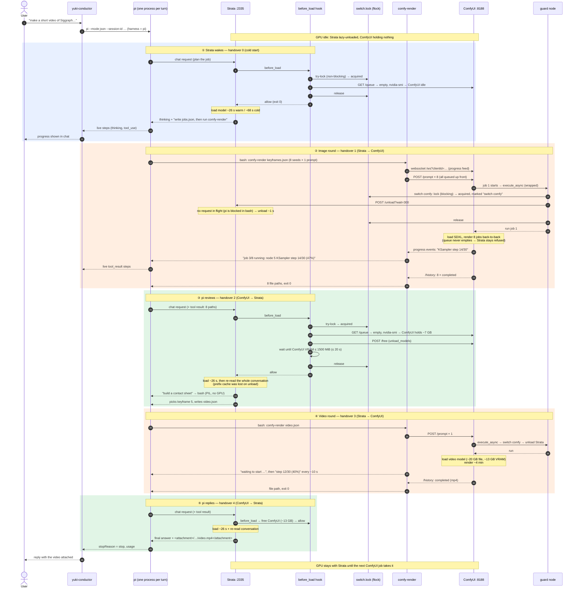

# How gpu-workload works

This machine has one 16 GB GPU (RTX 5070 Ti). Two services need almost all of
it:

| Service | What it is | VRAM when loaded |
| --- | --- | --- |
| **Strata** (`strata.service`, `:2335`) | local LLM, Qwen3.8-Flash-Next IQ2_XS; **pi** runs on it | ~14.7 GB |
| **ComfyUI** (`comfyui.service`, `:8188`) | image and video generation | 7 GB (SDXL) to 13+ GB (video) |

They can't both hold the GPU. `gpu-workload` makes them take turns, with no
caller ever having to manage the GPU:

- not yuki-conductor;
- not pi;
- not the scripts pi writes;
- not you in the ComfyUI web page.

This document covers:

- the pieces and how a full pi → ComfyUI → pi flow moves the GPU;
- the race conditions and deadlocks the design has to rule out, and how it does;
- how often the GPU changes hands, what each handover costs, and the
  best-effort measures that keep that number down.

Reference material, such as commands, flags and env vars, is in
[README.md](../README.md). ComfyUI maintenance is in
[comfyui-updates.md](comfyui-updates.md).

## 1. The pieces

| Piece | Where | Role |
| --- | --- | --- |
| `gpu-workload` CLI | `gpu-workload/gpu-workload`, on PATH | `status` / `switch` / `check` / `hold`, and Strata's hook. Reads state live; keeps no state file. |
| **Strata's `before_load` hook** | `strata-iq2_xs.json` → `gpu-workload hook strata-before-load`, with `before_load_strict: true` | Runs before Strata loads its model. Decides allow / refuse; may free an idle ComfyUI first. |
| **ComfyUI guard node** | `comfyui/gpu_workload_guard`, symlinked into `custom_nodes/` | Wraps `PromptExecutor.execute_async`; runs `gpu-workload switch comfy --wait 300` before **every** job. |
| `comfy-render` | `gpu-workload/comfy-render`, on PATH | Submits a batch of workflows, waits for **all** of them, and reports files or errors plus live progress. It never touches the GPU itself. |
| pi skill `comfyui-batching` | `pi/skills/`, symlinked into `~/.pi/agent/skills/` | Tells pi to use `comfy-render` and to batch. Best effort. |
| pi retry window | `~/.pi/agent/settings.json` | When Strata answers 503, pi retries for ~151 s instead of ~14 s. |
| Strata `lazy_load` | `strata-iq2_xs.json` | The service stays up holding no VRAM until a request arrives. |

### The design in one sentence

Each side takes the GPU for itself, at the moment it needs it:

| Wants the GPU | Who makes room | Rule |
| --- | --- | --- |
| Strata (a request from pi, curl, its web page) | Strata's `before_load` hook | ComfyUI has jobs → **refuse** (503). ComfyUI idle but holding models → free them, then allow. ComfyUI empty → allow. |
| ComfyUI (a job from comfy-render, a script, its web page) | the guard node | Let any answer Strata is writing finish, unload Strata, then run the job. If that can't happen in 300 s, **fail the job visibly**. |

Two consequences follow:

- **A render is never interrupted.** While ComfyUI has anything queued or
  running, Strata stays down.
- **An answer is never interrupted.** The guard waits for Strata's in-flight
  request before unloading it.

Everything else, such as which mode the GPU is "in", follows from those two
rules. `gpu-workload status` derives the mode from Strata `/health`, ComfyUI
`/queue` and `nvidia-smi` each time; nothing records it.

## 2. A full flow

The scenario:

1. A user asks, in web chat or Slack: *"make a short video of Siggraph
   chasing a butterfly"*.
2. pi plans it and renders candidate keyframes as images.
3. pi looks at a contact sheet and picks one.
4. pi renders the video from it.
5. pi replies with the result.

That gives four GPU handovers: one per render round in each direction.



### What each actor never has to do

- **yuki-conductor** knows nothing about the GPU. It runs pi, streams pi's
  events, and turns a "GPU busy" 503 into a readable reply.
- **pi** never calls `gpu-workload`. It runs `comfy-render` and asks Strata for
  its next step; the hook and the guard do the handovers.
- **comfy-render** queues and waits; the guard switches the GPU for each job it
  submits.

### Why pi never talks to Strata during a render

pi is a strict loop: ask the model → run the tool → ask the model again. While
`comfy-render` runs, pi is blocked inside that bash call, so no Strata request
can collide with the render from pi's side. That's also why the guard's
`/unload` in step ② finds Strata idle.

The design relies on that blocking. When it broke, as below, the system still
stayed safe, but the turn failed.

## 3. Race conditions

The safety argument has two parts:

- **Strata never loads while ComfyUI has a job**, because its hook refuses.
- **A ComfyUI job never runs while Strata is loaded**, because the guard unloads
  Strata first, or fails the job.

The races below are the gaps between "checked" and "acted" in each of those.

### 3.1 A ComfyUI job is queued just after the hook checked `/queue`

The hook reads `/queue` as empty and decides to free ComfyUI and allow
Strata. A new job lands in that gap.

Two things contain this:

- ComfyUI's `/free` only takes effect **between** jobs. With a job queued, the
  free is postponed, ComfyUI's VRAM doesn't drop, and the hook's wait for
  ≤ 1500 MiB times out after 20 s. The hook then refuses and Strata answers 503.
  The two never share the GPU.
- That new job's guard first runs `switch comfy`, which tries Strata's `/unload`.
  Strata isn't loaded (the load was refused), so the job runs.

If the job instead lands **after** the hook allowed Strata, its guard does
`switch comfy --wait 300`. That waits for Strata's in-flight request, then
unloads it. The job waits; nothing is interrupted.

### 3.2 The render script ends before ComfyUI's queue is empty

Observed on 2026-10-13. pi wrote its own polling script, which crashed on
`/history`'s shape after the first of four jobs. pi asked Strata for the
next step while three jobs were still queued.

The safety rule held: the hook refused (correctly) because ComfyUI had jobs,
and all four images rendered. But pi retried for ~14 s, gave up, and the turn
failed with "GPU busy".

Three fixes, from root cause outward:

1. **`comfy-render`** waits until *all* jobs reach `/history`. It never crashes
   on a bad job, and it reports one per line. The pi skill points pi at it, so
   pi doesn't hand-write polling loops.
2. **pi's retry window** went from 3 retries (~14 s) to 8 retries capped at 30 s
   (measured: gives up after 151 s). A render that's still finishing is
   outlasted.
3. **yuki-conductor** turns the eventual 503 into a readable reply, and reads
   failure from pi's `stopReason` rather than the exit code, since pi exits 0
   either way.

### 3.3 `switch comfy` reports "comfy" while Strata is still loading

Strata's model is "unloaded" right up to the moment the engine comes up. An
early version of `switch comfy` saw "not loaded", returned at once, and a
ComfyUI job could start while Strata was mid-load.

Fixed: `switch comfy` **always** calls Strata's `/unload` when the service runs.
`/unload` can't take Strata's request lock while a load holds it, so it answers
"busy" and is retried (`?wait=N`) until the load finishes, then unloads.

### 3.4 Two ComfyUI jobs and one Strata request interleave

Example: job A finishes, a Strata request arrives, then job B starts. This is
correct and safe:

- the hook frees ComfyUI and Strata loads;
- B's guard waits for Strata's answer and unloads it;
- B runs.

The cost is two extra handovers (~30 s each).

This happens when jobs are submitted one at a time with gaps between them,
which is exactly what `comfy-render` avoids by queuing a whole batch up front.
For a batch that must not be split even by unrelated traffic, such as another
conversation or a cron run, `gpu-workload hold comfy -- CMD` keeps the lock
marked `hold comfy`, and the hook refuses every Strata load until CMD exits.

### 3.5 Something outside the system uses the GPU

The guard covers every ComfyUI job, including ones queued from ComfyUI's own
web page. Strata's hook covers every Strata load.

Anything else that grabs VRAM isn't covered: another CUDA program, or a
ComfyUI custom node that loads models outside a job. `gpu-workload status`
shows that VRAM as `other`. Strata's `min_free_vram_mib: 14000` is the last
line of defence: Strata won't load into a GPU that lacks room. A job whose
model doesn't fit fails with ComfyUI's own out-of-memory error.

## 4. Deadlocks

Three locks are in play:

| Lock | Held by | Acquired how |
| --- | --- | --- |
| `~/.local/state/gpu-workload/switch.lock` (flock) | `switch`, `hold`, and the hook | **blocking** in `switch` / `hold`, **non-blocking** in the hook |
| Strata's request queue (`fifo`) | a running request or load | blocking for requests; **non-blocking** in `/unload` |
| ComfyUI's job worker | the running job, including its guard | one job at a time |

### 4.1 `switch strata` and the hook it triggers

`switch strata` takes `switch.lock`, then calls Strata's `/load`. That load
runs the `before_load` hook, which also wants `switch.lock`.

If the hook **waited** for the lock, the two would wait on each other forever:
`switch strata` waits for `/load`, `/load` waits for the hook, and the hook
waits for the lock `switch strata` holds.

Two choices avoid it:

- The hook only **tries** the lock. If someone else holds it, the hook reads the
  file, where the holder wrote what it's doing (`switch strata`,
  `switch comfy`, `hold comfy`):
  - `switch strata` → this load is the one it asked for → allow;
  - anything else → refuse.
- The hook frees ComfyUI **itself** rather than calling `switch strata`. Calling
  it would end in Strata's `/load` again, which would wait on the load that is
  running this very hook.

### 4.2 `hold` inside `hold`, `switch` inside `hold`

A render script run under `hold comfy` might call `gpu-workload switch comfy`
or another `hold`. Taking `switch.lock` again from inside would wait forever
on the outer hold.

`hold` sets `GPU_WORKLOAD_HOLD=comfy` in COMMAND's environment:

| Called inside a hold | Behaviour |
| --- | --- |
| `switch comfy` | no-op |
| `switch strata` | fails with a clear message |
| `hold` | runs its command directly |

### 4.3 The guard, the hook and Strata's request lock

Could the guard and the hook end up waiting on each other? The setup:

- **The hook** runs inside Strata's load, so it holds Strata's `fifo`, and it
  holds `switch.lock` while it frees ComfyUI (up to 20 s).
- **The guard** runs inside ComfyUI's job worker: `switch comfy`, which waits
  for `switch.lock`, then calls `/unload`, which needs `fifo`.

There is no cycle:

- `/unload` takes `fifo` **non-blocking**. It answers "busy" and is retried, so
  the guard never waits on `fifo` while holding `switch.lock`.
- The hook never waits on ComfyUI's worker. It only waits for ComfyUI's VRAM to
  drop, which is bounded at 20 s.

When both happen at once (a job starting just as Strata wakes), the timing goes:

1. The hook holds the lock.
2. The guard waits for it.
3. Either the hook's free succeeds and it allows the load, or ComfyUI's new job
   keeps its VRAM up, the hook times out and refuses.
4. The hook releases the lock.
5. The guard unloads Strata if it loaded, and the job runs.

This is a **bounded wait**, not a deadlock.

### 4.4 Every wait has a limit

| Waiter | Bound | On expiry |
| --- | --- | --- |
| hook: ComfyUI VRAM to drop | 20 s (`HOOK_RELEASE_TIMEOUT_S`) | refuse → Strata answers 503 |
| Strata: the hook itself | 30 s (`before_load_timeout_s`) | strict → 503 |
| guard: `switch comfy --wait` | 300 s (`GPU_WORKLOAD_GUARD_WAIT_S`), +120 s subprocess cap | job fails visibly: "GPU busy, job not run" |
| `switch strata`: Strata `/load` | `max(300, --wait)` s | switch fails, exit 1 |
| comfy-render: all jobs | 3600 s (`--timeout`) | exit 3 |
| pi: Strata 503s | ~151 s (8 retries, ≤ 30 s apart) | turn ends `stopReason: error` → "GPU busy" reply |
| yuki-conductor: pi silent | 1800 s (`CLAUDE_TIMEOUT`, idle) | run killed; comfy-render prints at least once a minute to prevent this |

The one unbounded wait is a `switch` or `hold` queuing behind another `hold`.
That's deliberate: a hold is a promise not to give the GPU up until its
command exits.

## 5. Exchange frequency

### 5.1 What one handover costs

Measured on this machine (RTX 5070 Ti, Strata IQ2_XS), 2026-10-12/13:

| Direction | Step | Time |
| --- | --- | --- |
| Strata → ComfyUI | guard: Strata `/unload` | ~1 s |
| | ComfyUI loads its model | SDXL ~10–25 s, video longer |
| ComfyUI → Strata | hook: ComfyUI `/free` | ~2 s |
| | Strata loads, warm (files in page cache) | ~26 s |
| | Strata loads, cold (read from disk) | ~68 s |
| | **Strata re-reads the conversation** (prefix cache lost on unload) | ~1 min per 30K tokens |

A full round trip, Strata → ComfyUI → Strata, costs **≥ 1 minute of overhead**
before any rendering, more as the conversation grows. The re-read is the cost
that keeps growing: in a long conversation it's the largest single item.

### 5.2 How many handovers a task takes

A task with *k* render rounds needs:

```
handovers = 2k              (one each way per round)
overhead  ≈ k × (unload + Comfy load + /free + Strata load + re-read)
```

The flow above has k = 2 (images, then video): 4 handovers plus the cold
start. Two things multiply this:

| Pattern | Handovers for N jobs | Why |
| --- | --- | --- |
| jobs submitted **one at a time**, with a Strata request between them | up to 2N | each gap lets Strata take the GPU back |
| jobs submitted **as a batch**, one `comfy-render` call | 2 | ComfyUI's queue never empties, so the hook refuses Strata throughout |
| re-rolling: render, look, render again | 2 per extra round | each look needs Strata |

The 四格 comic example from 2026-10-11 shows the multiplier. Handled by Claude,
it took three render rounds for one panel ("waffles", then "raw steak", then
right). On Strata that would be 6 handovers, about 3 minutes of pure overhead,
growing with each re-read.

### 5.3 Best-effort measures that keep it down

None of these are enforced; correctness never depends on them. They lower the
number and size of handovers.

| Measure | Where | Effect |
| --- | --- | --- |
| **Batch per round:** queue every job, then wait once | `comfy-render`, pi skill | N jobs → 2 handovers, not 2N |
| **Over-generate instead of re-rolling:** 6–8 seeds plus a few prompt variants for a risky shot | pi skill | turns extra rounds (2 handovers each) into extra jobs inside one round (~0 extra) |
| **Plan all prompts before the first render** | pi skill | one batch covers the whole task, instead of one per panel |
| **One contact sheet per round** | pi skill | one image for Strata's (CPU-side) vision to read, not N |
| **Non-GPU work outside the batch:** layout, captions, file moves | pi skill | doesn't put a Strata turn between two ComfyUI jobs |
| **Short tool output:** one summary line, throttled progress | `comfy-render`, pi skill | less text to re-read after each reload |
| **`hold comfy` for batches that must not be split** | `gpu-workload hold` | stops unrelated traffic (another chat, a cron run) from forcing two extra handovers mid-batch |
| **Lazy Strata, no idle unload** | Strata config | Strata unloads only when ComfyUI actually needs the GPU, never on a timer |
| **Free ComfyUI only when Strata needs it** | hook | ComfyUI keeps its model between jobs, so back-to-back renders skip the reload |

### 5.4 What's not reduced yet

- **The re-read.** Strata can save and restore its prefix cache to disk
  (`/slots/0?action=save|restore`, ~118 MB per slot). Saving before `/unload` and
  restoring after `/load` would replace the ~1 min/30K-token re-read with a file
  read. Not built yet; it needs checking that a restored slot is actually reused
  across an engine restart.
- **Waiting while blocked.** During a render the pi turn blocks inside bash.
  An async variant would let yuki-conductor end the turn while the GPU job runs,
  then wake pi with a new message when it's done. That changes nothing about
  handover count; it frees the conversation and removes the dependence on pi's
  retry window. Not built.
- **Token-level contention.** Strata serves one request at a time, so two
  conversations on pi queue behind each other. That's unrelated to the GPU
  handover, but it adds latency on top of it.

## 6. Observing it

- `gpu-workload status` shows the current mode, what each side holds, and the
  last event.
- `~/.local/state/gpu-workload/events.jsonl` keeps the last 500 decisions:
  every `switch`, every `hold` / `hold-end`, and every hook decision with its
  `source` (`hook` = during a switch or hold, `request` = a request that woke
  Strata) and `reason`. For example:

  ```
  strata-load  source=request allowed=true  reason="ComfyUI idle; freed its 7044 MiB of models"
  strata-load  source=request allowed=false reason="ComfyUI has 3 job(s) running or queued"
  switch       to=comfy ok=true previous=strata
  ```

  A run of `allowed=false` lines followed by a pi "GPU busy" reply is the
  signature of §3.2.
- **In ComfyUI's UI and `/history`:** a guard refusal shows as an
  `execution_error` "GPU busy, job not run: …".
- **In chat:** comfy-render's progress lines (`waiting to start …`, then
  `step N/M`) show as live steps while pi waits.
