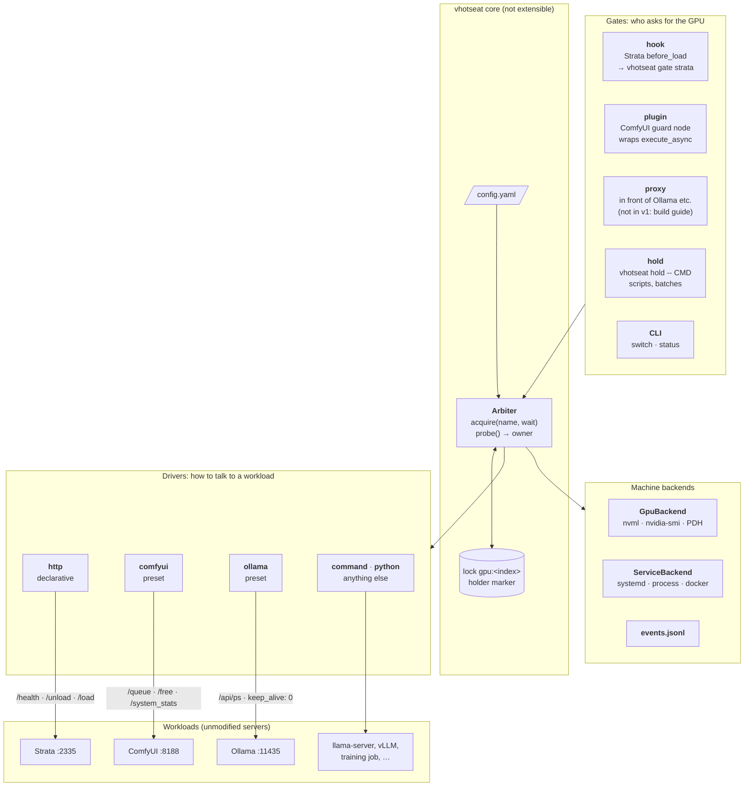
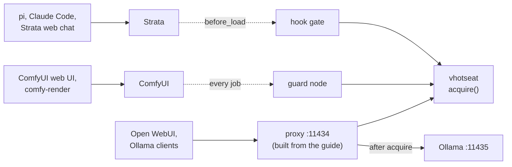
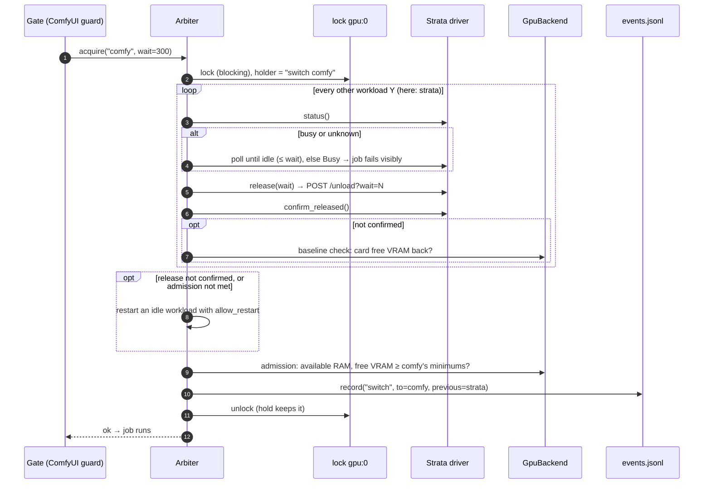
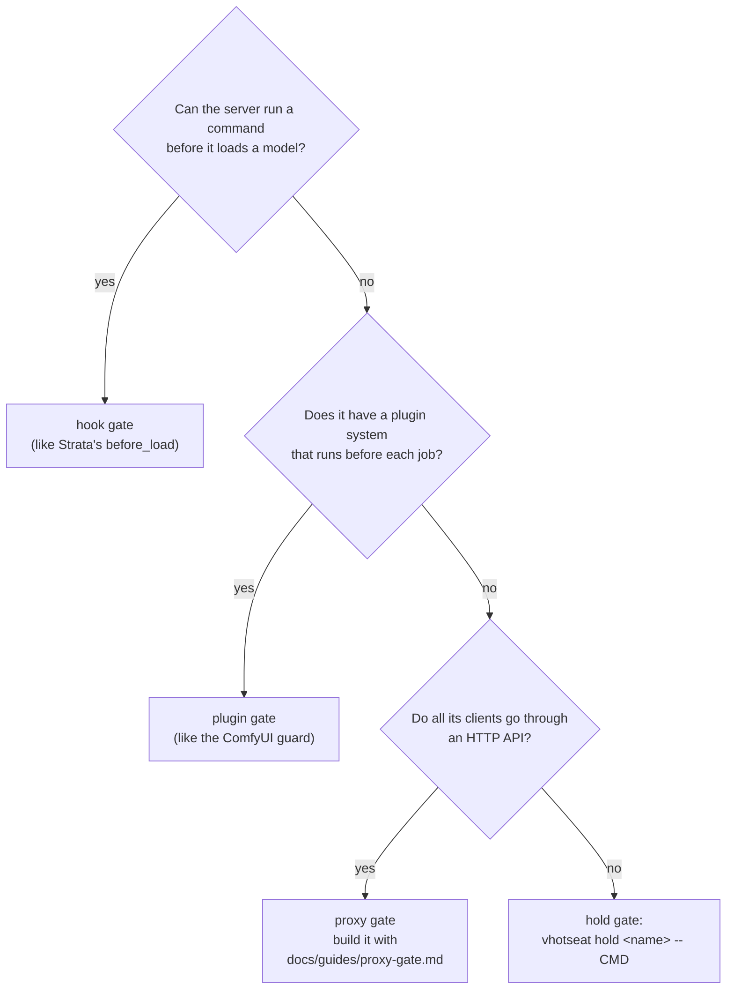

# vhotseat: turn gpu-workload into a generic, open-source GPU hotseat

Date: 2026-10-14 · Status: proposed

## 1. Goal

`gpu-workload` hands one GPU between two hard-coded servers, Strata and
ComfyUI. Most of what makes it work isn't specific to either:

- the GPU's owner is worked out live, with no state file;
- one lock, which records who holds it;
- `hold`, nested holds and bounded waits;
- the rule that **running work is never interrupted**.

**vhotseat** keeps that core and makes the workloads pluggable. Out of the box
it supports Strata and ComfyUI. Through config or a small plugin it
covers anything that can say "am I busy", "drop your VRAM" and "may I load".

> **vhotseat** (v-hotseat: VRAM hotseat). Take turns on one GPU. Hot-seat
> multiplayer: one device, players take turns, nobody is kicked out mid-turn.

The name is free on PyPI, npm and GitHub (user/org and repo), checked
2026-10-14.

### Decisions so far

| Decision | Choice |
| --- | --- |
| Sharing model | **Exclusive**: one workload owns the GPU at a time. No VRAM budgets or co-residency in v1. |
| Third workload, to prove the abstraction | **Ollama**, as a **design exercise only**: it shaped the driver contract and the proxy gate, but isn't used on this machine. v1 ships no proxy and no `serve`; it ships a build guide an agent can follow instead (§7). |
| Strata | Public ([Niko1221/Strata](https://github.com/Niko1221/Strata)). Ships as a config example for the generic `http` driver; no special code. |
| Name | `vhotseat`: CLI, PyPI package and GitHub repo |
| Platforms | Linux first. Windows is designed for from day one (pluggable backends) and shipped in a later phase. |
| Config format | YAML |
| ComfyUI calling Strata (nested use) | **Not supported.** The intended direction is an agent on the LLM driving ComfyUI. For ComfyUI driving Strata, point users to [Comfyui-Strata-T8](https://github.com/T8mars/Comfyui-Strata-T8) (§6). |
| Repo | Continue in `wandering-vibe/gpu-workload` for now; move the history to its own repo (`git filter-repo`) before the public release |
| Licence | MIT |
| Daemon | None in v1: stateless CLI + lock file. No `serve`; proxy gates are built from a guide (§7) |
| Agent kit | `comfy-render`, the batching skill and setup/maintenance skills ship in the vhotseat repo, outside the core (§8) |

### Non-goals (v1)

- Sharing one GPU between workloads at the same time (VRAM budgets, MIG, MPS).
- Multi-GPU scheduling. The lock is keyed by GPU index so this can come later.
- Swapping models inside one server. Ollama and llama-swap already do that;
  vhotseat arbitrates between servers.
- Interrupting or pre-empting work. Never.
- WSL2 mixed with native Windows (see §9.4).
- One workload's job calling another workload mid-job, e.g. a ComfyUI node
  that calls Strata (see §6).

## 2. Prior art and positioning

| Project | What it does | Gap vhotseat fills |
| --- | --- | --- |
| [llama-swap](https://github.com/mostlygeek/llama-swap) (~6k★) | Proxy that swaps between OpenAI-compatible LLM backends | LLM servers only, and it controls them. It doesn't take turns with non-LLM apps such as ComfyUI, and doesn't protect a running job. It could be a vhotseat workload. |
| Ollama's scheduler | Loads and evicts models inside Ollama | Only Ollama's own models |
| [T8mars/Comfyui-Strata-T8](https://github.com/T8mars/Comfyui-Strata-T8) | ComfyUI nodes that call Strata, with a same-GPU handoff around each node | ComfyUI drives and Strata is a subroutine. Unloads after every use. Other clients of Strata aren't covered. Tied to its own runtime protocol. |

**Pitch:** the servers stay as they are, and every client is covered: web UIs,
agents, curl and cron all go through the same gate. A running job is never
interrupted, and the GPU changes hands only when the other side actually
needs it.

### Lessons taken from Comfyui-Strata-T8

| Lesson | Where it lands |
| --- | --- |
| Fail closed: an incomplete status is never treated as idle | `busy` / `resident` may be `None` (unknown); the core treats unknown as busy (§4.1) |
| A real busy signal (`activity.in_flight`) | Optional `busy` in the driver; ask upstream Strata for `in_flight` (§11) |
| Admission check on free VRAM and RAM before loading | `admission.min_available_ram_mib` / `min_free_vram_mib` (§4.3) |
| Wait for free VRAM to return to its baseline after a release | `confirm` falls back to the card's free VRAM baseline (§4.1 #7) |
| Escalate when a release can't be confirmed | `allow_restart` (§4.3) |
| Check the endpoint's identity | `vhotseat doctor` check (§4.1 #5) |
| Key the lock by GPU, not by app | `gpu:<index>` lock (§5) |
| Unload after every use as an option | Not adopted; on-demand only (§4.3 #14, Appendix A) |
| ComfyUI Registry, CI, protocol versions, Windows | §10 phases 3–4 |

Their nodes and our guard **don't work together**: a Strata node runs inside a
ComfyUI job, so Strata's hook sees a running ComfyUI job and refuses. That's
out of scope (§6); the two projects cover opposite directions.

## 3. Architecture

### 3.1 Components

Layered top to bottom: a gate asks, the core decides, drivers act on the
workloads. Each workload's own clients keep talking to it as before; the gate
sits at the server's front door (hook, plugin) or in front of it (proxy).



Where each gate lives, for the three example workloads:



### 3.2 acquire(): one handover

ComfyUI job arrives while Strata holds the GPU.



### 3.3 Gate decision when the lock is held

Hook gates run inside the workload's own load, so they never block on the
lock. They read the holder marker instead (today's how-it-works §4.1 rule,
generalized).


The lock and the `acquire` algorithm are **not** extensible, because that's
where the safety rules live. Plugins describe workloads; they never change how
arbitration works.

### Modes become owners

| Today | vhotseat |
| --- | --- |
| `strata` / `comfy` / `conflict` | `owner: <name>` · `owner: none` (nothing resident) · `conflict: [a, b]` |

### CLI

```
vhotseat status [--json]                     # who owns the GPU, what each workload holds, last event
vhotseat switch <name>|none [--wait S] [--json]   # take the GPU for <name> (or free it); idempotent
vhotseat hold   <name> [--wait S] -- CMD...  # take it and keep it until CMD exits
vhotseat gate   <name>                       # entry point for hook gates (Strata's before_load)
vhotseat doctor [--exercise <name>]          # check config, backends, gates and patches; --exercise runs a real cycle
```

Exit codes stay the same: `0` ok · `1` failed or refused · `2` usage.
`hold` exits with CMD's own code once CMD has started.

Compared with the first draft, `check` and `run` are gone, `switch none` is
new, and `proxy` / `serve` are not in v1: a proxy gate is the one
long-running process vhotseat would need, and v1 has no workload that
requires one (§7). Appendix A gives the reasons.

## 4. Extension points

Each point below has a one-line description, how the three example workloads
fill it, and a **v1** verdict from the self-review in Appendix A:
**core** (required), **optional** (a default exists; a workload may override
it), **merged** or **cut** (not in v1).

### 4.1 Driver contract: what vhotseat asks a workload

A driver answers questions about one workload and performs the one action
vhotseat needs from it: dropping its VRAM.

| # | Point | What it is | Strata | ComfyUI | Ollama | v1 |
| --- | --- | --- | --- | --- | --- | --- |
| 1 | **reachable** | Whether the workload's API answered at all. Separates "stopped/down" from "up but idle". | the `/health` request answered | the `/queue` request answered | the `/api/ps` request answered | merged into the status probe; not configured separately |
| 2 | **resident** | Whether it holds models in VRAM right now. Decides who owns the GPU. | `/health` `$.loaded` | its VRAM (GPU backend) > `idle_vram_mib` | `/api/ps` `models` non-empty | core |
| 3 | **busy** | Whether it is doing work that must not be interrupted. The basis of "never interrupt". | not exposed; a 409 on release says it; later `in_flight` | `/queue` running + pending > 0 | proxy's in-flight count (`/_vhotseat/status`) | core (may be "learned from release") |
| 4 | **vram_mib** | How much VRAM it holds. Used to confirm a release, show status, and catch a process that holds VRAM while its API is down. | GPU backend: cgroup `strata.service` | GPU backend: cgroup `comfyui.service` (`/system_stats`' `torch_vram_total` doesn't count loaded models: 64 MiB reported with SDXL's 7 GB loaded, 2026-10-17) | `/api/ps` sum of `size_vram` | optional (GPU backend attribution by default) |
| 5 | **identity** | Proof that the server on the port is the one configured. | `/v1/models` id | `/system_stats` version | `/api/version` | cut from runtime; a `doctor` check |
| 6 | **release(wait)** | Ask it to drop its VRAM without interrupting work, waiting up to `wait` for work to finish. | `POST /unload?wait=N`; 409/`busy` → Busy; `release_always` | `POST /free {unload_models, free_memory}` | proxy drains, then `keep_alive: 0` per model | core |
| 7 | **confirm** | Check the VRAM is actually gone, since release calls return before it is. | vram → 0 | vram ≤ `idle_vram_mib` | `/api/ps` empty | core (card-baseline default) |
| 8 | **load** | Load ahead of the first request, so `switch X` leaves X warm. Gates never call it. | `POST /load` | – (lazy) | optional warm-up of `default_model` | optional |
| 9 | **service** | Which service unit or process runs it, so vhotseat can start a stopped one and restart a stuck one. | `systemd --user strata` | `systemd --user comfyui` | `systemd ollama` | optional (default `none`) |
| 10 | **before_release / after_load hooks** | Per-workload actions around a handover. | (would save/restore the prefix cache) | – | – | cut until open question 3 is answered |

Each probe answers `True` / `False` / `None` (unknown). **The core treats
unknown as busy and resident.** Today `_comfy_jobs()` returns 0 when `/queue`
can't be reached; that gets fixed along the way.

For **confirm**, if no workload-level check is configured, the core waits for
the card's free VRAM to return to within 256 MiB of what it was before the
other workload loaded (the baseline). This works on every platform and with
Docker.

### 4.2 Gates: how a workload asks for the GPU

A gate is the code that runs *before* a workload touches the GPU and calls
`Arbiter.acquire(name, wait)`. Without one, a workload can load on top of
another; the gate is what makes vhotseat a guarantee rather than a
convention.

| # | Point | What it is | Strata | ComfyUI | Ollama | v1 |
| --- | --- | --- | --- | --- | --- | --- |
| 11 | **kind** | Where the gate runs: `hook` (the server runs a command before loading), `plugin` (code inside the server), `proxy` (vhotseat in front of the server's API), `hold` (a CLI wrapper around a command). | `hook`: `before_load: ["vhotseat","gate","strata"]`, `before_load_strict: true` | `plugin`: guard node wraps `PromptExecutor.execute_async` | `proxy`: `:11434` → `:11435`; model routes gated | `hook`, `plugin`, `hold` core. `proxy` designed, not shipped: build guide (§7). `wrap` merged into `hold` |
| 12 | **on_busy** | What the gate does while another workload is busy: refuse now, or wait up to N seconds and then refuse. | `refuse` (Strata's hook limit is 30 s) | `wait: 300`, then fail the job | `wait: 120`, request held open | optional (default set per kind) |
| 13 | **busy reply** | How a refusal reaches the user. | Strata's 503 + `Retry-After` | `execution_error` "GPU busy, job not run" | 503 + `Retry-After`, `{"error": …}` | cut as a config point; fixed by each gate kind |

A process that isn't a server (a training script, a one-off CUDA tool) is a
workload with no driver ops, gated with `hold`: `vhotseat hold train --
python train.py`. While CMD runs, the lock is held, so every other gate waits
or refuses.

### 4.3 Policies (config only)

Knobs that change *when* or *how strictly* the core acts, with no code.

| # | Point | What it is | Strata | ComfyUI | Ollama | v1 |
| --- | --- | --- | --- | --- | --- | --- |
| 14 | **release_policy** | When a workload gives the GPU up: `on-demand` (only when someone else asks), `after-use`, or `idle:<s>`. | on-demand | on-demand | on-demand | cut; `on-demand` only. Use each server's own idle unload, or `switch none` |
| 15 | **admission** | What must be available before this workload may load: `min_available_ram_mib` (RAM, counting reclaimable cache) and `min_free_vram_mib`. Doesn't decide *whether* others release (they always do); decides whether vhotseat goes on to restart idle workloads, and whether the load is allowed. | `min_available_ram_mib: 38000`, `min_free_vram_mib: 14500` | none (varies per workflow) | per model, if built | optional (no check by default); strongly recommended for big loads and on Windows |
| 16 | **allow_restart** | Whether vhotseat may restart this workload's service when it's idle and releasing isn't enough: its VRAM won't drop, or another workload's admission needs RAM it still holds. | `true` | `true` | `true` | optional (default `false`) |

### 4.4 Machine-wide

One per install, not per workload.

| # | Point | What it is | v1 | Later |
| --- | --- | --- | --- | --- |
| 18 | **GpuBackend** | Reads the card's total/free VRAM and attributes VRAM to processes. | core: `nvml`, `nvidia-smi` fallback; cgroup attribution on Linux | Windows PDH + process tree; AMD `amd-smi` |
| 19 | **ServiceBackend** | Starts, checks and restarts the process behind a workload (#9). | optional: `systemd-user`, `systemd`, `none` | `docker`, `process` (Windows Job Objects) |
| 20 | **EventSink** | Where decisions are recorded. | fixed `jsonl`, not pluggable | `command`, `webhook` if anyone asks |

(#17, nested leases, was removed with §6.)

### 4.5 How a workload plugs in

1. **Preset:** `driver: comfyui`. v1. (`driver: ollama` comes with a proxy
   gate; see §7.)
2. **`http`:** request + JSON-path + status-code rules in YAML (Strata,
   llama-server, vLLM). v1.
3. **Python:** a class registered under the `vhotseat.drivers` entry point.
   v1, since the presets are built this way anyway.
4. **`command`:** one shell command per operation. Deferred: every GPU server
   in view has an HTTP API, and a non-server process uses `hold`.

### 4.6 Python interfaces

```python
@dataclass
class Status:
    reachable: bool
    resident: bool | None     # None = unknown → treated as resident
    busy: bool | None         # None = unknown → treated as busy
    vram_mib: int | None

class Workload(Protocol):
    name: str
    release_always: bool      # Strata: a load may be under way before VRAM shows
    def status(self) -> Status: ...
    def release(self, wait: float) -> None: ...   # raises Busy / ReleaseFailed; never interrupts
    def load(self, timeout: float) -> None: ...   # optional; NotImplemented = lazy
    def confirm_released(self, s: Status) -> bool: ...
    def ready_to_restart(self) -> bool: ...     # default True; ComfyUI: queue empty, last result read

class Gate(Protocol):
    def serve(self, arbiter: "Arbiter") -> None: ...

class GpuBackend(Protocol):
    def card(self) -> tuple[int, int]: ...                # total_mib, free_mib
    def usage_by(self, selector) -> int | None: ...       # None if not attributable (WDDM)

class ServiceBackend(Protocol):
    def is_active(self) -> bool: ...
    def start(self) -> None: ...
    def restart(self) -> None: ...

```

## 5. Core algorithm

`acquire(X, wait)` keeps today's `to_strata` / `to_comfy` behaviour, written
once:

1. Take the lock for `gpu:<index>`. Mark the holder `switch X` or `hold X`.
   - **Same target, no wait:** if the lock is held and the marker says
     `switch X` or `hold X`, a gate for X proceeds without taking the lock.
     For hook gates this is today's deadlock rule (how-it-works §4.1),
     generalized. It also fixes a bug in today's code: a ComfyUI job started
     during `hold comfy` blocks in the guard on the hold's lock until the
     guard's 420 s timeout, while the held script waits for that job.
   - Hook gates only **try** the lock; for any other holder they refuse.
     Other gates wait for it (up to `wait`).
2. **Release, always.** For every workload Y ≠ X that is resident or
   `release_always`, whatever X's admission says (ownership is exclusive):
   1. `busy` true or unknown → wait up to `wait`, polling, else raise Busy.
   2. `Y.release(wait)` → `Y.confirm_released`, or the baseline check, within
      the release timeout.
   3. Not confirmed → step 3 for Y; if Y can't be restarted, raise.
3. **Restart, only if needed.** While a release wasn't confirmed, or X's
   admission isn't met: pick an idle Y with `allow_restart`, preferring the
   one holding the most RAM; if `Y.ready_to_restart()` (ComfyUI: queue still
   empty and the newest result finished ≥ 10 s ago, since a restart wipes
   `/history`), restart its service and wait for it to answer. Never restart a
   busy workload.
4. **Admission check.** `MemAvailable` ≥ `min_available_ram_mib` and card free
   VRAM ≥ `min_free_vram_mib`, else raise, naming the resource that was short.
5. If called from `switch`: `X.load()` when supported. Gates skip this; the
   workload loads itself. `switch none` stops after step 2.
6. Record the event, including available RAM and each workload's memory.
   Release the lock, or keep it for `hold`.

This is how the code before phase 1 (commit `a9f7317`, 2026-10-16) restarts an idle
ComfyUI before Strata loads, with one change: today the trigger is ComfyUI
holding over 4 GiB of RAM + swap. On 2026-10-16 that missed a case: ComfyUI
was under the threshold, Strata loaded anyway, and systemd-oomd killed it.
Here the trigger is the incoming workload's admission, which is the question
that actually decides whether a load fits.

`probe()` → `owner` = the single workload that's resident, or the `hold`
holder; `conflict` if there's more than one; `none` if there are none.

## 6. Out of scope: one workload calling another mid-job

Example: a ComfyUI node that calls Strata while its job runs, as
[Comfyui-Strata-T8](https://github.com/T8mars/Comfyui-Strata-T8) does. The
ComfyUI job owns the GPU, so Strata's hook sees ComfyUI busy and refuses.
Waiting would deadlock, because the job is waiting on Strata.

**Not supported.** vhotseat is built for the opposite direction: an agent on
the LLM drives ComfyUI, and each side takes the GPU between steps. Users who
want ComfyUI to drive Strata should use Comfyui-Strata-T8, which handles the
handoff inside its nodes, and not install the vhotseat guard on that ComfyUI.

The README says so plainly. `vhotseat doctor` warns when it finds both the
guard and Comfyui-Strata-T8 with `same_gpu: true` installed.

If it's ever needed, the design sketched during planning was a lease token
created by the guard for each job, plus a `vhotseat borrow <name> --lease
TOKEN` that lets code inside that job lend the GPU to another workload and
take it back. One open problem was that ComfyUI's `/free` only acts between
jobs, so the lender's models would have to be unloaded from inside the job.

## 7. Proxy gate: designed, built from a guide

**v1 doesn't implement a proxy gate or `vhotseat serve`.** Nothing on this
machine needs one: Strata has a hook and ComfyUI has a plugin. Ollama was the
third workload only to test that the design stretches. A proxy would be the
only long-running vhotseat process, with its own failure modes (streaming,
restarts, latency) and nobody here to exercise it. Shipping it untested is
worse than not shipping it.

Instead, v1 ships **`docs/guides/proxy-gate.md`**: a detailed guide that a
user's coding agent follows to build a proxy gate for their server (Ollama,
llama-server, vLLM, LM Studio). The core provides the API it builds on (§7.3),
so the proxy is an add-on, not a change to vhotseat.

### 7.1 Why some workloads need a proxy

Why a proxy: vhotseat needs two things from every workload, and Ollama has
neither.

1. **A gate.** Something has to run *before* the workload loads a model, so
   vhotseat can free the GPU first or refuse. Strata has `before_load` and
   ComfyUI has custom nodes, but Ollama loads a model whenever a request names
   it, with no hook and no plugins. Without a gate, Ollama loads on top of a
   rendering ComfyUI: out of memory on Linux, or a silent spill into system
   RAM on Windows (§9.2).
2. **A busy signal.** Before releasing a workload, vhotseat must know it isn't
   mid-answer. Ollama's `/api/ps` lists loaded models but not in-flight
   requests.

A proxy in front of Ollama provides both: it calls `acquire("ollama")` before
forwarding, and it counts the requests it is forwarding. Nothing in Ollama or
its clients changes. The same proxy covers any server with an HTTP API and no
hook (llama-server, vLLM, LM Studio).

### 7.2 Proxy design (the spec the guide expands)

- Listens on `127.0.0.1:11434`; upstream is Ollama on `:11435`
  (`OLLAMA_HOST`). Existing clients don't change.
- **Gated routes** (they load a model): `/api/chat`, `/api/generate`,
  `/api/embed`, `/api/embeddings`, `/v1/chat/completions`, `/v1/completions`,
  `/v1/embeddings`. Everything else is passed through unchanged (`/api/tags`,
  `/api/pull`, `/api/ps`, …).
- **Fast path:** while Ollama owns the GPU and no switch is pending, skip the
  lock and forward. Ownership is cached in memory and invalidated through a
  "switch pending" flag in the lock file, read with a cheap `stat`. It must
  not run nvidia-smi on every request.
- **Busy signal:** the proxy counts in-flight requests, including streaming
  ones until the stream closes. It serves `/_vhotseat/status`
  `{in_flight, draining}`, which the Ollama driver reads.
- **Release:** set `draining` (new requests wait at the gate), wait for
  `in_flight == 0` within `wait`, then `keep_alive: 0` for every model in
  `/api/ps`, then confirm `/api/ps` is empty.
- **When another workload is busy:** hold the request open up to
  `on_busy.wait`, then 503 + `Retry-After`. Most Ollama clients handle a slow
  answer better than a 503.
- Streaming: pass bytes through without buffering (`httpx` / `aiohttp`).
  Measure the added latency (target < 1 ms on the fast path).
- **The same proxy works for any OpenAI-compatible server** (llama-server,
  vLLM, LM Studio, Strata without its hook) with `driver: http`. This is
  probably the largest group of users.

**Open question for whoever builds it:** does `keep_alive: 0` wait for in-flight requests in Ollama, or
can it cut a stream short? Draining makes this moot for traffic through the
proxy, but not for clients that talk to `:11435` directly. Document "don't do
that".

### 7.3 What the v1 core provides for it

A proxy built from the guide must not need changes to the core. So v1 makes
these public and tested, even though nothing in v1 calls them from a
long-running process:

| Core API | What the proxy uses it for |
| --- | --- |
| `vhotseat.acquire(name, wait)` / `release_lock()` as a Python API (not only the CLI) | the gate itself, without spawning a process per request |
| A cheap "lock state" read: holder marker plus a generation counter bumped on every switch | the fast path: forward without taking the lock while the generation is unchanged and this workload owns the GPU |
| Driver `busy` read from an HTTP endpoint (`http` driver, `busy: {get: …, path: …}`) | the proxy publishes `{in_flight, draining}`; the workload's driver reads it, so the core needs no proxy-specific code |
| A drain step in release: `release: {pre: {post: <proxy>/_vhotseat/drain}}` | stop new requests and wait for in-flight ones before `keep_alive: 0` |
| `doctor` checks for a configured proxy: it listens, the upstream answers, and the upstream port isn't the one clients use | the "client bypasses the proxy" mistake |

### 7.4 Contents of the guide

Written for a coding agent, in the same style as the setup skills (§8.3):
a procedure, with checks at each step.

1. **Decide whether you need a proxy at all,** using the gate decision tree
   (§8.3). Most servers with a pre-load hook or plugins don't.
2. **Map the server's API:** which routes load a model, which don't, how
   streaming responses end, how to unload (`keep_alive: 0`, `/slots`, a
   restart), and how to tell it's loaded.
3. **Move the server to an internal port** and put the proxy on the public
   one, so existing clients don't change. Record the old config.
4. **Build the proxy** against §7.2 and the core API in §7.3: route
   classification, in-flight counting that covers streams to the last byte,
   draining, the fast path, holding a request while another workload is busy,
   503 + `Retry-After` after the wait.
5. **Add the workload to `config.yaml`** with an `http` driver that reads the
   proxy's status and drains through it.
6. **Run it as a service** (systemd unit template included), started before
   the server's clients.
7. **Test,** with a checklist the guide spells out:
   - a streamed answer is never cut off by `vhotseat switch comfy`;
   - a request during a ComfyUI render waits, then gets 503 if the render
     outlasts the wait;
   - added latency on the fast path (target < 1 ms) and time to first token;
   - `doctor --exercise <name>` passes;
   - killing the proxy mid-stream leaves the lock and the server in a sane
     state.
8. **Known traps:** clients still pointed at the internal port; servers that
   unload on their own timer (`OLLAMA_KEEP_ALIVE`); request bodies the proxy
   must read to classify a route (buffer them, but never responses); keep-alive
   connections that outlive a drain.

Appendix: a worked example for Ollama, using §4.1's Ollama column as the
answers to step 2.

## 8. Agent kit

vhotseat's core makes taking turns **safe**. The headline use case, a local
LLM agent driving ComfyUI on the same GPU, also needs it to be **cheap**, and
it needs an agent to be able to **set it up and extend it**. The agent kit
covers both. It ships in the vhotseat repo but stays outside the core: nothing
in the core depends on it, and every guarantee holds without it.

### 8.1 Why it's part of the project

| | Without vhotseat | Without the agent kit |
| --- | --- | --- |
| Result | Collisions: out of memory on Linux, a silent slowdown on Windows | Safe, but slow and fragile, and hard to set up |
| What goes wrong | An agent's request loads the LLM on top of a render | N jobs submitted one at a time cost up to 2N handovers (≥ 1 min each, plus re-reading the conversation). A hand-written polling script that crashes lets the agent ask the LLM for its next step mid-batch, and the turn fails with "GPU busy" (how-it-works §3.2, seen 2026-10-13). Every setup step, such as editing Strata's config, installing the guard, moving Ollama's port, or patching a node that leaks VRAM, is manual. |

Nothing else covers this. llama-swap and Ollama's scheduler only swap LLMs,
and Comfyui-Strata-T8 works in the other direction (§2). The README's
quickstart is built around it.

### 8.2 Runtime kit: for the agent doing GPU work

| Piece | Today | In vhotseat |
| --- | --- | --- |
| `comfy-render` | `gpu-workload/comfy-render`. Queues a whole batch up front, waits for every job, prints one line per job and progress at least once a minute. | A second command in the vhotseat package, after the cleanup in §8.2.1. New: `--hold`, which runs the batch inside `vhotseat hold comfy`, so no unrelated traffic can split it. Needs the hold + guard fix (A.6 #1). |
| `comfyui-batching` skill | `pi/skills/comfyui-batching`: batch, generate extra variants instead of re-rolling, plan every prompt before the first render, one contact sheet per round | Reworded for any agent ("an LLM on the same GPU" instead of "you run on Strata"), in the Agent Skills `SKILL.md` format that Claude Code, Codex and pi all read |
| Retry guidance | pi's `settings.json`: 8 retries, ≤ 30 s apart (~151 s) | A short doc section: an agent harness on a gated LLM must retry 503 + `Retry-After` for at least as long as a batch's tail, or turns fail at the end of renders |

Why comfy-render works: while ComfyUI's queue is non-empty, every LLM load is
refused, so a batch costs 2 handovers instead of 2N; and the agent stays
blocked in the command, so it can't ask the LLM anything mid-batch.

#### 8.2.1 Shipping comfy-render

It's a single standard-library Python file (~500 lines) that doesn't import
anything from gpu-workload; the GPU handover is the guard's job. So shipping it
is mostly cleanup, tests and packaging.

**Packaging.** It ships inside the vhotseat package, not as a package of its
own. `pip install vhotseat` / `uv tool install vhotseat` installs both
commands, still with no extra dependencies:

```toml
[project.scripts]
vhotseat = "vhotseat.cli:main"
comfy-render = "vhotseat.kit.comfy_render:main"
```

The source moves to `src/vhotseat/kit/comfy_render.py`. It stays independent of
the core: it doesn't import vhotseat, and `--hold` calls the `vhotseat hold`
CLI, so comfy-render works with ComfyUI alone. Until the repo moves (phase 3),
a one-line wrapper keeps `gpu-workload/comfy-render` working, so the
`~/.local/bin` symlink and pi's skill don't change.

**What ties it to this machine** (everything else is already generic: the
batch formats, the websocket progress, one line per job, exit codes 0–4):

| Today | Change |
| --- | --- |
| `COMFY_DIR` defaults to `~/Codebase/ComfyUI`; used to turn output names into absolute paths and to trim tracebacks | `--comfy-dir` / `VHOTSEAT_COMFY_DIR`. Without it, print paths relative to ComfyUI's output folder (`output/<subfolder>/<file>`) and say so. ComfyUI's API doesn't report its output folder, so it can't be found automatically. |
| `COMFY_URL` env var | Add `--url`; keep `COMFY_URL` |
| `CANCELLED_BY` names the wandering-gallery dashboard | "cancelled by the user (ComfyUI or another client)" |
| Comments that explain the unbounded wait in terms of Strata | "an LLM sharing the GPU"; the guard mentioned as "the vhotseat guard, if installed" |

**Before it ships:**

1. **Tests.** None today. Batch formats, override paths, the reading of
   `/prompt` rejections, `/history` results, runtime errors, cancellation and
   the no-progress timeout, against a fake ComfyUI serving `/prompt`, `/queue`,
   `/history` and a websocket. The same fake server backs the core's tests
   (phase 0).
2. **Results from the websocket, not only `/history`.** A ComfyUI restart
   (§5 step 3) wipes `/history`, and comfy-render reads results from it every
   2 s. That's why the restart waits 10 s after the last job (`ready_to_restart`).
   comfy-render already listens to the websocket: take each job's outputs from
   its `executed` events and its outcome from `execution_success` /
   `execution_error` when `/history` no longer has the job. Then a restart
   can't lose comfy-render's results. (Done in phase 1. The 10 s wait stays
   for other `/history` readers.)
3. **Docs for people, not just agents:** how to export a workflow in API
   format, an example batch file with variants, what each exit code means.
4. **ComfyUI updates.** It relies on ComfyUI's public response formats
   (`/history` status messages, websocket events), not private methods, so
   it's less fragile than the guard. The `vhotseat-comfyui-update` skill runs a
   comfy-render smoke batch as well as the guard checks.

The `comfyui-batching` skill ships next to it in `kit/skills/`, reworded as in
the table above. Generalize it after the edits currently in progress on it
land.

This is a per-workload companion, not a core concept. ComfyUI needs a batching
client because its work is a queue of separate jobs. Ollama doesn't, because
the LLM requests are the agent itself, and plain processes already get the
same protection from `hold`. Generalize only when a second workload needs it.

### 8.3 Setup and maintenance skills: for the user's coding agent

Everything we did by hand to get this machine working becomes a skill, so a
user can tell their agent "set up vhotseat" or "add support for X". The docs
stay the source of truth; each skill is a short procedure that points at them.

| Skill | What it walks the agent through | Generalized from |
| --- | --- | --- |
| `vhotseat-setup` | Find GPU workloads on the machine (listening ports, systemd units, processes on the GPU). Write `config.yaml`. Install each gate: Strata's `before_load` keys; the ComfyUI guard (`comfy node install vhotseat-guard` or a symlink). For a server that needs a proxy, hand off to the proxy guide (§7). Then `doctor`, then the smoke tests. | README install sections, how Strata's config and the guard symlink were set up |
| `vhotseat-add-workload` | Add support for a new server. (1) Find its API for each driver point (§4.1): what says loaded, what says busy, what releases. (2) Pick a gate with the decision tree below. (3) Write an `http` config, or a Python driver if YAML can't express it. (4) Check it with `doctor --exercise <name>` (§8.4). (5) Optionally contribute it upstream as a preset. | How Strata, ComfyUI and Ollama were mapped onto §4 in this plan |
| `vhotseat-comfyui-update` | After a ComfyUI update: check the guard loaded, check the wrapped method's signature, run the smoke tests, and roll back if needed. The guard depends on a private method, so this is the most likely thing to break. | `docs/comfyui-updates.md` |
| `vhotseat-vram-leak` | A workload's release "succeeds" but its VRAM doesn't drop, so `confirm` times out and every handover is refused. Diagnose it: reproduce standalone, render, unload, list `gc.get_objects()` tensors still `is_cuda`. Fix the node or extension that keeps them, and record the patch (§8.4). | `docs/tts-audio-suite-vram.md` (IndexTTS kept 2 GB after `/free`) |

Gate decision tree for `vhotseat-add-workload`:



**What "patching ComfyUI" means here.** We don't modify ComfyUI's own source.
The kit covers two different things:

- **The guard** is a custom node. It wraps a private ComfyUI method
  (`PromptExecutor.execute_async`) at runtime. A ComfyUI update can break it,
  which is why `vhotseat-comfyui-update` exists. Upstream ask: a public
  pre-execute hook (§11).
- **Third-party node fixes**, such as the TTS Audio Suite patch, are real
  source patches to a custom node pack. They're machine-specific and
  undone by every update of that pack, which is why `vhotseat-vram-leak` and
  the patch registry exist.

Rules every setup skill follows:

- **Ask before changing anything outside vhotseat:** a server's config, a
  port, a systemd unit, third-party code. Show the diff first.
- **Keep a backup** of every config it edits (as with
  `strata-iq2_xs.json.pre-lazy`).
- **End by checking:** `vhotseat doctor`, plus the smoke test for that
  workload. Don't report success without it.

### 8.4 Small core additions the kit needs

| Addition | Why |
| --- | --- |
| `vhotseat doctor --exercise <name>` | Actually runs a cycle on one workload: take the GPU, load, release, confirm, with timings. It's the test for a new driver, and the "verify" step of every skill. Opt-in, because it unloads things. |
| `patches:` in the config | A list of local patches to third-party code, each with a file and a marker string (`LOCAL PATCH (vhotseat)`). `doctor` greps for the markers and warns when an update has removed a patch, before the next handover fails. |

```yaml
patches:
  - name: TTS Audio Suite IndexTTS unload
    file: ~/Codebase/ComfyUI/custom_nodes/TTS-Audio-Suite/engines/index_tts/indextts/infer_v2_5.py
    marker: "LOCAL PATCH (vhotseat)"
    doc: ~/.config/vhotseat/patches/tts-audio-suite.md
```

### 8.5 Layout and what stays personal

```
vhotseat/
  src/vhotseat/              core, drivers, CLI
  src/vhotseat/kit/comfy_render.py   the comfy-render command (§8.2.1)
  integrations/comfyui/      guard node (ComfyUI Registry: vhotseat-guard)
  integrations/strata/       before_load snippet, example config
  kit/skills/
    comfyui-batching/
    vhotseat-setup/
    vhotseat-add-workload/
    vhotseat-comfyui-update/
    vhotseat-vram-leak/
  docs/
    guides/proxy-gate.md     build a proxy gate (§7)
```

Skills are installed by copying or symlinking them into the agent's skills
folder (`~/.claude/skills`, `~/.pi/agent/skills`, …); the setup skill offers
to do it.

**Stays in wandering-vibe:** yuki-conductor specifics, pi's `settings.json`,
the Akine voice skill, the TTS Audio Suite patch itself (an *example* of a
recorded patch goes into the docs), and this machine's measurements.

## 9. Windows

All three apps run natively on Windows. Strata via its portable bundle,
ComfyUI via its portable zip or Desktop, Ollama via its tray app. None runs as
a Windows service by default.

### 9.1 VRAM accounting

- On GeForce cards under WDDM, `nvidia-smi --query-compute-apps` and NVML
  report per-process `used_memory` as `[N/A]`. Only cards in TCC mode report
  it. Card totals (`memory.total`, `memory.free`) do work.
- Process names are `python.exe` / `ollama.exe` at install-specific paths.
- Desktop processes hold a varying 0.5–2 GB.

So on Windows the order is: **the workload's own figure** (Ollama `/api/ps`,
ComfyUI `/system_stats`) → **PDH `GPU Process Memory(pid_*)\Dedicated
Usage`** (what Task Manager uses; works for any vendor) summed over the
server's process tree with psutil → **baseline of card free VRAM**. The same
order is better on Linux too: no path matching, and it works with Docker.

### 9.2 Sysmem fallback

Since driver 536.40, the Windows driver spills CUDA allocations into shared
system RAM instead of running out of memory. Collisions don't crash; both
sides just run 5–20× slower. Therefore:

- admission checks are the real safety net on Windows;
- `vhotseat status` / `doctor` warn when `GPU Adapter Memory\Shared Usage`
  shows CUDA spilling;
- the docs recommend "CUDA – Sysmem Fallback Policy: Prefer No Sysmem
  Fallback" for the server executables.

### 9.3 Platform layer

| Area | Linux | Windows |
| --- | --- | --- |
| Lock | `fcntl.flock` | `msvcrt.locking` on the same file (holder text kept) |
| Service | systemd | `process` backend: start a `.bat`/exe detached inside a Job Object, track by PID; optional NSSM / `sc` |
| Restart | `systemctl restart` | terminate the Job Object, relaunch |
| `hold` signal forwarding | SIGINT/TERM/HUP | new process group + Job Object; Ctrl+Break |
| Paths | XDG | `%LOCALAPPDATA%\vhotseat` (`platformdirs`) |
| CLI | entry point | `vhotseat.exe` via pip entry point |

### 9.4 WSL2

Inside WSL, nvidia-smi sees the card but no processes, and native Windows
can't see WSL's file lock. Unsupported in v1. A later option is a lock served
over localhost HTTP by a small vhotseat service.

## 10. Phases

Each phase ships on its own and leaves this machine working.

### Phase 0: refactor in place, behaviour identical

- Split `gpu-workload` into a package: `core` (arbiter, lock, events),
  `drivers/` (`strata_http`, `comfyui`), `gpu/nvidia_smi`, `service/systemd`.
- `to_strata` / `to_comfy` → `acquire()`; the hook → generic `gate`.
- Fix the `hold` + guard lock wait (§5 step 1).
- Keep the ComfyUI restart from `a9f7317`: the four scenarios tested by hand in
  the README become tests, with a fake cgroup.
- Keep the `gpu-workload` CLI name and env vars as a compatibility shim.
  Strata's `before_load` and the guard keep working unchanged.
- Fix fail-open: an unreachable `/queue` means busy=unknown, not 0.
- **Tests:** fake HTTP servers for Strata and ComfyUI, a fake GPU backend.
  The fake ComfyUI also serves its websocket, and comfy-render gets its own
  tests against it (§8.2.1).
  Cover every race in how-it-works §3 and every deadlock in §4 as scenarios.
  There are no tests today; this is the biggest gap before going public.
- **Done when:** the test suite passes, and the pi → ComfyUI → pi flow in
  how-it-works §2 works end to end on this machine.

### Phase 1: config and generic drivers

- `~/.config/vhotseat/config.yaml` (§12), validated by a schema; `vhotseat
  doctor`.
- `http` driver. Strata moves to an `http` config with no code.
- ~~`comfyui` preset uses `/system_stats` for VRAM~~: dropped, it doesn't count
  loaded models (§4.1 #4). ComfyUI's VRAM comes from NVML attributed by its
  systemd unit; the 1500 MiB idle threshold stays.
- `nvml` backend; cgroup attribution by systemd unit.
- Rename the CLI to `vhotseat`; ~~`gpu-workload` stays as an alias for one
  release~~ `gpu-workload` removed at the switchover (below).
- Admission (`min_available_ram_mib`, `min_free_vram_mib`), `allow_restart`,
  baseline confirm, `switch none`.
- comfy-render: `--url`, `--comfy-dir`, personal references removed, results
  taken from the websocket when `/history` has lost them (§8.2.1). The 10 s
  history wait in ComfyUI's `ready_to_restart` **stays**: other clients read
  `/history` too (comfy-cli, the wandering-gallery dashboard).

**Done 2026-10-17.** As built:

- Config at `~/.config/vhotseat/config.yaml` (example: `config.example.yaml`),
  validated with the key path in every error. A broken config makes gates
  refuse, never allow.
- `vhotseat` CLI: `status`, `switch NAME|none`, `hold`, `gate`, `doctor`.
  `gpu-workload` keeps its exact interface and reads the same config (it needs
  workloads named `strata` and `comfy`); without a config it uses its old
  built-in setup and env vars.
- State moved to `~/.local/state/vhotseat/` with a symlink from the old path.
  GPU 0's lock keeps the name `switch.lock`, so an old `gpu-workload` (a
  rollback, or a hook pointing at an old copy) takes the same lock. A
  different file would let both hand the GPU over at once; it happened once
  during testing, harmlessly.
- Admission is checked only for a workload about to load: one that already
  holds the GPU would count its own memory against itself.
- The RAM trigger moved from "ComfyUI holds > 4 GiB" to Strata's admission:
  `min_available_ram_mib: 46000` for IQ3_XXS (measured: its load took 44.5 GiB
  of available RAM, 42.5 GiB resident after, 56 GiB at the load's peak).
  `restart_above_ram_mib` remains as an option, unset in the example.
- `doctor` checks the GPU backend, RAM, each service and API, and each gate:
  Strata's `before_load` (runs vhotseat or gpu-workload, strictly, with a
  timeout that fits) and the ComfyUI guard node. `--exercise` and `patches:`
  are phase 2.

**Switchover, 2026-10-17.** Strata's `before_load` runs `vhotseat gate strata`,
the ComfyUI guard runs `vhotseat switch comfy`, and the wandering-gallery
dashboard calls `vhotseat` (its `generate.gpuWorkload`). The `gpu-workload`
CLI, its compatibility layer and its `GPU_WORKLOAD_*` env vars are removed;
`check` and `hook` went with it. How to go back:
[../revert-gpu-workload.md](../revert-gpu-workload.md). Found on the way: a
`switch` to a lazy workload (ComfyUI) with nothing loaded reported failure,
since the mode is then `none`, not `comfy`; the old CLI had hidden it by
calling an idle GPU "comfy".

**Follow-ups, 2026-10-17.**

- **Admission per model.** `admission.by_model` gives each model its own
  figures, picked when it loads from what the `http` driver's `model:` request
  says (Strata's `/health` reports its model even while unloaded). So
  `strata-model` switching sizes needs nothing from vhotseat. An unlisted or
  unreadable model gets the defaults, the largest model's figures. Measured
  from idle: IQ3_XXS took 44.5 GiB of available RAM, IQ2_XS 38.2 GiB, both
  ~14.7 GB of VRAM. `doctor` says which model's figures apply.
- **Guard renamed** to `vhotseat_guard`, settings `VHOTSEAT_GUARD`,
  `VHOTSEAT_GUARD_WAIT_S`, `VHOTSEAT_BIN`. It won't wrap a job runner the old
  `gpu_workload_guard` already wrapped, so having both installed by mistake
  can't make every job switch twice.

### Phase 2: extensibility proven without a third workload

- `doctor --exercise` and `patches:` (§8.4).
- The core API a proxy needs (§7.3), with tests that drive it from a fake
  long-running gate.
- **Write `docs/guides/proxy-gate.md`** (§7.4), with the Ollama worked
  example.
- Write the `vhotseat-add-workload` skill.
- **Test both with a fresh agent session**, in a scratch worktree, given only
  the skill, the guide and the docs: add llama-server support, which needs a
  proxy. Check it against the guide's test checklist. Whatever the agent gets
  stuck on, or gets wrong, is fixed in the guide or the skill. The proxy it
  builds is thrown away; the guide is the deliverable.
- Example configs: llama-server, vLLM (marked "needs a proxy, see the guide").

**Progress, 2026-10-17.** Built and tested (115 tests):

- `doctor --exercise NAME`: a real cycle under the lock (take, load, resident,
  release, released), timed, logged as an `exercise` event, GPU left free.
- `patches:` with `fixed_upstream_in`, so `doctor` says when an update has the
  fix and a local patch can go (the IndexTTS one: PR #373, released in 5.10.4;
  installed here: 5.10.2).
- The proxy's core API: `vhotseat.api` (`open`, `owns` on the fast path, `acquire`,
  `release_all`, `holder`, `generation`), a per-GPU generation counter, and
  `release.pre` (a drain request before unloading), full URLs in `http`
  requests. A burst of requests now makes one handover, not one each (found by
  the API's tests: waiters re-did the switch after the first had done it).
- `docs/guides/proxy-gate.md` with an Ollama appendix; its config block is a test.
- `kit/skills/vhotseat-add-workload/SKILL.md`.

**Left:** the end-to-end check, a fresh agent adding llama-server from the guide
and the skill only. It needs a llama.cpp build and a small GGUF model on this
machine (none here yet).

### Phase 3: open-source release (Linux)

- Until here, work continues in `wandering-vibe/gpu-workload/`. Now move it to
  a new repo `vhotseat` (MIT) with `git filter-repo --subdirectory-filter
  gpu-workload`, so its history comes along; leave a pointer behind.
- PyPI package; ComfyUI guard published to the ComfyUI Registry as
  `vhotseat-guard`.
- CI: lint, tests, Python 3.10–3.13.
- Agent kit (§8): `comfy-render` moved into the package as a second command
  (`src/vhotseat/kit/`), `comfy-render --hold`, the batching skill
  generalized, the four setup and maintenance skills.
- Docs: README (pitch + a quickstart built around "your local LLM agent drives
  ComfyUI on the same GPU"), a generalized `how-it-works.md`, a
  driver-authoring guide (the long form of `vhotseat-add-workload`), one
  example config per workload.
- Personal things stay behind (§8.5).

### Phase 4: Windows

- `msvcrt` lock, PDH GPU backend, `process` service backend with Job Objects,
  sysmem-fallback warning.
- Needs a Windows NVIDIA tester (T8's users are the natural pool) to confirm
  the WDDM `[N/A]` behaviour, the PDH counters and sysmem fallback.

## 11. Upstream asks

| Project | Ask | Why |
| --- | --- | --- |
| Strata | `in_flight` (and per-process VRAM) in `/health` or `/v1/status` | real busy signal instead of a 409 on release |
| Strata | document `/unload?wait` and `before_load` as a stable integration point | vhotseat's Strata gate depends on them |
| ComfyUI | a public pre-execute hook | the guard wraps a private method (`docs/comfyui-updates.md`) |
| Ollama | busy / in-flight in `/api/ps` | would let Ollama work without the proxy for status |

## 12. Example config

The config in use is `gpu-workload/config.example.yaml`; the sketch below is
the design-time version (the Ollama entry is not in v1).

```yaml
gpu: {index: 0, backend: nvml}

workloads:
  strata:
    driver: http
    url: http://127.0.0.1:2335
    service: {systemd-user: strata}
    vram: {cgroup: strata.service}
    resident: {get: /health, path: $.loaded}
    release:
      post: /unload?wait={wait}
      always: true
      busy_when: {status: 409}
      ok_when: {path: $.status, in: [unloaded, not loaded]}
    confirm: {vram_at_most: 0}
    load: {post: /load, timeout: 300}
    gate: {kind: hook, on_busy: refuse, timeout: 20}
    admission:
      # RAM the machine must be able to give Strata before it may load: its
      # experts plus working memory (~38 GiB for IQ2_XS, measured), with some
      # headroom. Compared with *available* RAM (MemAvailable on Linux), which
      # counts page cache the kernel can drop on demand. *Free* RAM is always
      # small on a busy machine and would refuse almost every load.
      # When other workloads still hold too much RAM after releasing their
      # models, idle ones with allow_restart are restarted; if that still isn't
      # enough, the load is refused and the event log says RAM was short.
      min_available_ram_mib: 38000
      # VRAM that must be free on the card before Strata may load (~14.5 GB).
      # VRAM has no cache the driver gives back by itself, so free is what's
      # usable. Other workloads always release the GPU first, whatever this
      # says; this catches what vhotseat doesn't manage (the desktop, a game,
      # a release that left VRAM behind) and, on Windows, a load that would
      # silently spill into system RAM (§9.2).
      min_free_vram_mib: 14500
    allow_restart: true

  comfy:
    driver: comfyui
    url: http://127.0.0.1:8188
    service: {systemd-user: comfyui}
    idle_vram_mib: 1500
    gate: {kind: plugin, on_busy: wait, timeout: 300}
    # No admission: what ComfyUI needs depends on the workflow, and it manages
    # its own memory. Other workloads still release the GPU before every job.
    # Restart it when its release leaves VRAM behind, or when a workload's
    # admission needs RAM that its idle process still holds (6-15 GiB after a
    # video render). Only when its queue is empty and its last result has been
    # read (see ready_to_restart, §5).
    allow_restart: true

  # Not in v1: needs a proxy built from docs/guides/proxy-gate.md (§7).
  ollama:
    driver: ollama
    upstream: http://127.0.0.1:11435
    service: {systemd: ollama}
    gate: {kind: proxy, listen: 127.0.0.1:11434, on_busy: wait, timeout: 120}
    allow_restart: true

events: {keep: 500}   # ~/.local/state/vhotseat/events.jsonl
```

## 13. Open questions

1. **Ollama `keep_alive: 0` during a stream** (§7): does it wait for
   in-flight requests, or cut them short? For whoever builds an Ollama proxy.
2. **Strata prefix-cache save/restore** across an engine restart (how-it-works
   §5.4): does a restored slot actually get reused? If so it becomes a
   `before_release` / `after_load` hook.

### Decided 2026-10-14/15

| Question | Decision |
| --- | --- |
| Config format | YAML |
| ComfyUI calling Strata mid-job (nested leases) | Not supported; see §6 |
| Repo | Stay in this repo; `git filter-repo` into `vhotseat` at phase 3 |
| Licence | MIT |

## Appendix A: self-review of the CLI and extension points

For each command and extension point: is it really needed, and what breaks or
goes missing without it? The test for "needed": would a v1 user, or one of the
three example workloads, hit a safety hole, a deadlock or a dead end without
it? Anything that only adds convenience or anticipates a future user is cut or
deferred. It's easier to add a point later than to remove a documented one.

Usage data from this machine (`events.jsonl`, 2026-10-12 to 2026-10-14):
152 Strata hook decisions, 103 switches (65 of them from `conflict`, i.e. the
ComfyUI guard taking the GPU from a loaded Strata), 3 holds (all tests), and no
uses of `check` outside the docs.

### A.1 CLI

| Command | Verdict | Why it's needed | Without it |
| --- | --- | --- | --- |
| `status` | **keep** | The only way to see who owns the GPU, what each workload holds, and the last decision. It's the first thing anyone runs when a job is refused. `--json` feeds scripts and dashboards. | Debugging means reading three APIs, nvidia-smi and the event log by hand. |
| `switch <name>` | **keep** | Every gate other than the hook calls it: the ComfyUI guard runs `switch comfy --wait 300` before every job (65 of 103 switches here). By hand, it pre-warms a workload (`switch strata` loads the model) or moves the GPU on purpose. | Gates would need an in-process API in every language, and users couldn't move the GPU themselves. |
| `switch none` | **add** | Releases every workload without choosing a new owner: freeing the card for a game or a one-off tool, or an "unload at night" cron. This replaces the `release_policy` knob (#14). | The only way to empty the GPU would be switching to some workload, which loads that workload. |
| `hold <name> -- CMD` | **keep** | Two jobs: (1) keeps the GPU through a batch whose queue may go empty between jobs, so unrelated traffic can't split it (how-it-works §3.4); (2) gates a plain process that has no server, such as a training script. | (1) A multi-step render script loses the GPU between steps and pays two handovers each time. (2) A training run has no gate, so a Strata request loads on top of it. |
| `gate <name>` | **keep** | The command a hook gate runs (Strata's `before_load`). It's the only CLI entry that tries the lock without waiting, so it can't deadlock against the switch that triggered the load. | Strata has no gate, so any request would load it on top of a ComfyUI render. |
| `serve` / `proxy` | **not in v1; replaced by a build guide** | Would run proxy gates, the only long-running vhotseat process. No v1 workload needs one: Strata has a hook, ComfyUI a plugin. Shipping a streaming proxy nobody here runs would mean shipping it untested. | Servers with no hook (Ollama, llama-server, vLLM) aren't gated out of the box. Users close the gap with `docs/guides/proxy-gate.md` (§7), built on the core API in §7.3. |
| `doctor` | **keep** | Gates live *outside* vhotseat: a line in Strata's config, a symlink in ComfyUI's `custom_nodes`, a moved Ollama port. If one is missing, nothing fails; the guarantee silently stops holding. `doctor` checks each gate is installed and reachable, the config is valid, the GPU backend works, and that each server is the one configured (#5). | A missing gate is found by an out-of-memory crash, or on Windows by a 10× slowdown with no error (§9.2). |
| `check <name>` | **cut** | Was "exit 0 if X owns the GPU, 3 otherwise", for scripts. Nothing calls it, and it's racy: ownership can change between the check and the work. The right tool is `switch` (take it) or `hold` (take and keep it). | A script that only wants to know uses `status --json`. Exit code 3 goes away with it. |
| `run <name> -- CMD` | **merged into `hold`** | Was "CMD *is* the workload". That's `hold` on a workload with no driver ops: same lock, same lifetime, same refusal of other gates. | Nothing; one command fewer to explain. |

### A.2 Driver contract (§4.1)

| # | Point | Verdict | Why it's needed | Without it |
| --- | --- | --- | --- | --- |
| 1 | reachable | **merge into status** | Needed: "API down" must not be read as "idle". But it doesn't need its own config entry; the status probe either answers or doesn't, and "no answer" makes `resident`/`busy` unknown. | As a separate point: duplicate config with no effect. Without the distinction at all: today's fail-open bug, an unreachable ComfyUI counted as 0 jobs. |
| 2 | resident | **core** | Defines ownership (`probe()`), and decides which workloads `acquire` must release. | vhotseat would release every workload on every switch, or never know there's a conflict. |
| 3 | busy | **core** | It's what "never interrupt work" rests on: the gate waits or refuses while another workload is busy. A driver may declare "busy is learned from release" (Strata today: a 409 from `/unload`). | Gates would release workloads mid-job. ComfyUI's `/free` would be queued behind the render while the gate waited, and Ollama would drop a model mid-stream. |
| 4 | vram_mib | **optional** | Used three ways: (a) confirming a release; (b) catching a process that holds VRAM while its service or API is down (today: "a Strata process holds VRAM but strata.service is stopped"); (c) `status` output. The default is the GPU backend's per-process attribution, so a driver only overrides it when the server knows better (Ollama, ComfyUI). | Without any attribution: (b) is lost, which is a real hole, since a crashed-but-resident server would look free. With only the default: fine on Linux, blind on Windows (§9.1). That's why the override exists. |
| 5 | identity | **cut from runtime, keep in `doctor`** | Protects against the configured port being served by something else (a second ComfyUI, an old Ollama). That's a setup mistake, found once, not something that changes per switch. | At runtime, nothing: a wrong server would fail its other probes anyway. As a `doctor` check it catches the mistake early. |
| 6 | release(wait) | **core** | The one action vhotseat needs from a workload. | There's nothing to arbitrate with. |
| 7 | confirm | **core, with a default** | Release calls return before the VRAM is free (ComfyUI's `/free` is deferred; Strata's engine takes a moment to exit; the TTS Audio Suite leak kept 2 GB after `/free` reported success). The default, waiting for the card's free VRAM to return to its baseline, needs no driver code. | Loading straight after release would collide with VRAM still being freed: an out-of-memory error, or a refusal from Strata's own `min_free_vram_mib`. |
| 8 | load | **optional** | Only `switch X` calls it, to leave X warm (`switch strata` → model loaded, first answer immediate). Gates never call it; each workload loads itself. | `switch strata` would leave Strata cold, and the first request would pay the 26–68 s load. Correctness is unaffected. |
| 9 | service | **optional, default `none`** | Two uses: starting a stopped workload during `switch`, and restarting it (`allow_restart`). | Users would start services themselves; a stuck release would need a manual restart. Neither is a safety problem. |
| 10 | before_release / after_load | **cut** | Its only candidate is Strata's prefix-cache save/restore, and whether that works is open question 3. A general hook interface designed for one unproven use is likely to be wrong. | Nothing today. If the experiment works, add it then, shaped by the real use. |

### A.3 Gates (§4.2)

| # | Point | Verdict | Why it's needed | Without it |
| --- | --- | --- | --- | --- |
| 11 | kind: `hook` | **core** | The gate for servers that run a command before loading (Strata). Zero extra processes; refusals reach clients as the server's own 503. | Strata would need a proxy in front of it. That works, but adds a hop to every token stream and a process to keep running. |
| 11 | kind: `plugin` | **core** | The gate for servers that load inside their own job runner (ComfyUI). Nothing outside the server sees "a job is about to load models". | A proxy in front of ComfyUI's `/prompt` would only see *submission*, not *start*. A queued job could start long after the gate approved it, by which time Strata may have reloaded. |
| 11 | kind: `proxy` | **designed; build guide in v1** | The only gate for servers with no hook and no plugin system (Ollama, llama-server, vLLM, LM Studio): most of the open-source audience. It also provides Ollama's missing busy signal (#3). | vhotseat would only work with servers that have a hook or plugin: Strata and ComfyUI. |
| 11 | kind: `hold` | **core** | The gate for processes that aren't servers. See `hold` in A.1. | Training scripts and CUDA tools would be ungated. |
| 12 | on_busy | **optional, defaults per kind** | The right reaction differs by gate. A hook runs inside the server's own time limit (Strata: 30 s), so it must refuse quickly. A ComfyUI job can afford to wait minutes. A proxy can hold an HTTP request open while the client waits. | One fixed policy would either break hooks (waits past the server's limit, so the load fails anyway with a worse error) or make ComfyUI jobs fail every time Strata is mid-answer. |
| 13 | busy reply | **cut as a config point** | Each gate kind has exactly one sensible way to refuse: hook → non-zero exit (the server turns it into its own error); plugin → the server's error mechanism; proxy → 503 + `Retry-After`. | Nothing to configure. The behaviour stays, fixed by kind. |

### A.4 Policies (§4.3)

| # | Point | Verdict | Why it's needed | Without it |
| --- | --- | --- | --- | --- |
| 14 | release_policy | **cut; on-demand only** | `after-use` is T8's model (unload after every use). It costs a full reload per call, which is exactly the overhead vhotseat exists to avoid; the one use that needed it, nested calls, is out of scope (§6). `idle:<s>` duplicates what servers already do (Strata `idle_unload`, Ollama `keep_alive`, ComfyUI's own caching) and would need a daemon to fire the timer. | Users who want a free GPU at times use `switch none` (by hand or from cron) or the server's own idle unload. |
| 15 | admission | **optional, no check by default** | RAM is shared even though the GPU isn't: an idle ComfyUI kept 6–15 GiB after `/free`, and on 2026-10-16 Strata's ~38 GiB load on top got yuki-conductor and then Strata itself killed by systemd-oomd. Checking the incoming workload's need is what decides whether to restart. For VRAM: on Linux, a load that doesn't fit fails loudly, so it's a nicety. On Windows it is **the** safety net: sysmem fallback means a load that doesn't fit still "succeeds", and both workloads crawl (§9.2). It also catches VRAM held by something outside vhotseat (a game, the desktop). | Windows users get silent slowdowns. On Linux: a clearer refusal becomes a server-side out-of-memory error. |
| 16 | allow_restart | **optional, default `false`** | Releases do get stuck (the TTS Audio Suite leak kept 2 GB until ComfyUI restarted), and released workloads can keep RAM another one needs. Restarting recovers automatically, only when the workload is idle. On this machine it's routine: 5 ComfyUI restarts on 2026-10-16. Default `false` because restarting someone's server is drastic; `doctor` suggests it when the event log shows a stuck release or a RAM refusal. | A stuck release blocks every handover until a human restarts the service, as it did on 2026-10-13. |

### A.5 Machine-wide (§4.4)

| # | Point | Verdict | Why it's needed | Without it |
| --- | --- | --- | --- | --- |
| 18 | GpuBackend | **core interface, v1 ships NVIDIA only** | The card's free VRAM is needed for the baseline confirm (#7) and admission (#15), and per-process VRAM for #4. Making it an interface costs nothing now. Without it, Windows (§9.1) and AMD would mean rewriting the core. | Hard-coded nvidia-smi: Windows shows `[N/A]` per process and AMD doesn't work at all. |
| 19 | ServiceBackend | **optional; v1 ships systemd and `none`** | Backs #9. Users run servers under systemd, Docker, a `.bat` file or a terminal; a small interface keeps that out of the core. | Only systemd users get auto-start and restart. Everyone else sets `none` and loses only convenience. |
| 20 | EventSink | **cut as an extension point** | The event log is needed: it's how every refusal is explained after the fact. But there's one consumer today (`status` and humans), and any webhook or dashboard can tail a JSONL file. | Nothing; a fixed `events.jsonl`. Add sinks if users ask. |
| – | `command` driver | **deferred** | Would cover workloads with no HTTP API. None is in view: every GPU server considered has HTTP, and non-servers use `hold`. | A workload with only a CLI needs a small Python driver; the plugin interface covers it. |
| – | Python entry-point drivers | **keep** | The presets are written against this interface anyway; registering it as an entry point is a few lines. It's the escape hatch that lets the YAML-level `http` driver stay simple. | Every unusual workload would need a vhotseat release. |

### A.6 Gaps found by this review

1. **`hold` and the ComfyUI guard block each other (bug in today's code).**
   During `hold comfy`, a ComfyUI job's guard runs `switch comfy`, which waits
   on the lock the hold owns. The held script waits on that job, so nothing
   moves until the guard's subprocess timeout (300 + 120 s), and then the job
   fails as "GPU busy". Reproduced on 2026-10-14 with a held lock: `switch
   comfy` blocked. It hasn't happened in practice; all three holds in the log
   predate the guard. The `GPU_WORKLOAD_HOLD` env var only helps commands
   started by the hold, and the guard runs inside ComfyUI's process instead.
   **Fix:** "same target, no wait" (§5 step 1): a gate for X proceeds when the
   lock's marker says `switch X` or `hold X`. Phase 0.
2. **Unknown must mean busy.** Already in §4.1. The review confirms it's
   load-bearing for #1, #2 and #3: merging `reachable` into status is only
   safe because "no answer" becomes unknown, not idle.
3. **Nothing frees the GPU without picking an owner.** That was the gap left by
   cutting `release_policy`; fixed by `switch none`.
4. **A missing gate is silent.** Every guarantee depends on gates installed
   outside vhotseat; `doctor` is the only thing that notices a missing one.
   `status` should show its last result, and the setup skill ends with it.
5. **Hook gates have a hard time limit vhotseat doesn't control.** Strata's
   `before_load_timeout_s` (30 s) bounds the hook's whole run, including
   releasing others. `on_busy` for a hook must stay under it, and `doctor`
   should compare the two.

### A.7 Agent kit additions (§8)

| Item | Verdict | Why it's needed | Without it |
| --- | --- | --- | --- |
| `comfy-render` | **keep, outside the core; same package** | Turns 2N handovers into 2, and closes the how-it-works §3.2 failure where an agent asks the LLM mid-batch. | Safe but slow; first-time users hit "GPU busy" at the end of their first multi-job render. |
| `comfy-render --hold` | **keep** | The one link from the kit to the core: stops unrelated traffic (another chat, a cron run) from splitting a batch. | Two extra handovers whenever other traffic lands mid-batch. Correctness is unaffected. |
| `comfyui-batching` skill | **keep** | The agent has to *know* to batch, over-generate and plan ahead; comfy-render only helps if it's used. | Agents write their own polling loops and re-roll one image at a time. |
| Setup and maintenance skills | **keep** | Every gate lives outside vhotseat, in other projects' configs and folders. Setting them up and keeping them working after updates is where users get stuck, and it's exactly what a coding agent can do from a good procedure. | Setup is a page of manual steps per workload; a ComfyUI update can silently switch the guard off. |
| `doctor --exercise` | **keep (flag, not a command)** | The only end-to-end test of a driver, and the "verify" step every skill ends with. A flag on `doctor` rather than a new command, in line with A.1. | A new driver is first tested by a real collision. |
| `patches:` registry | **keep** | Fixes to third-party code are undone silently by updates, and the symptom (every handover refused) shows up far from the cause. This happened with TTS Audio Suite. | The symptom returns after an update and gets debugged from scratch. |

