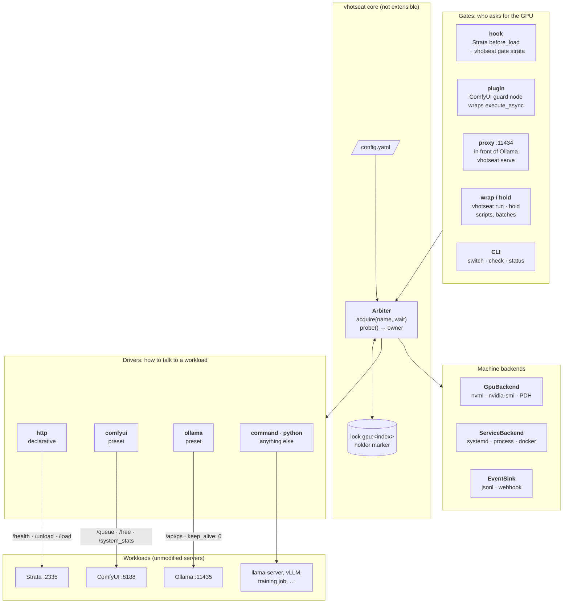
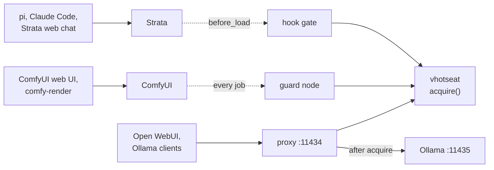
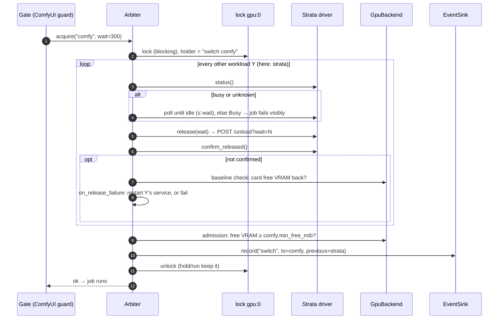
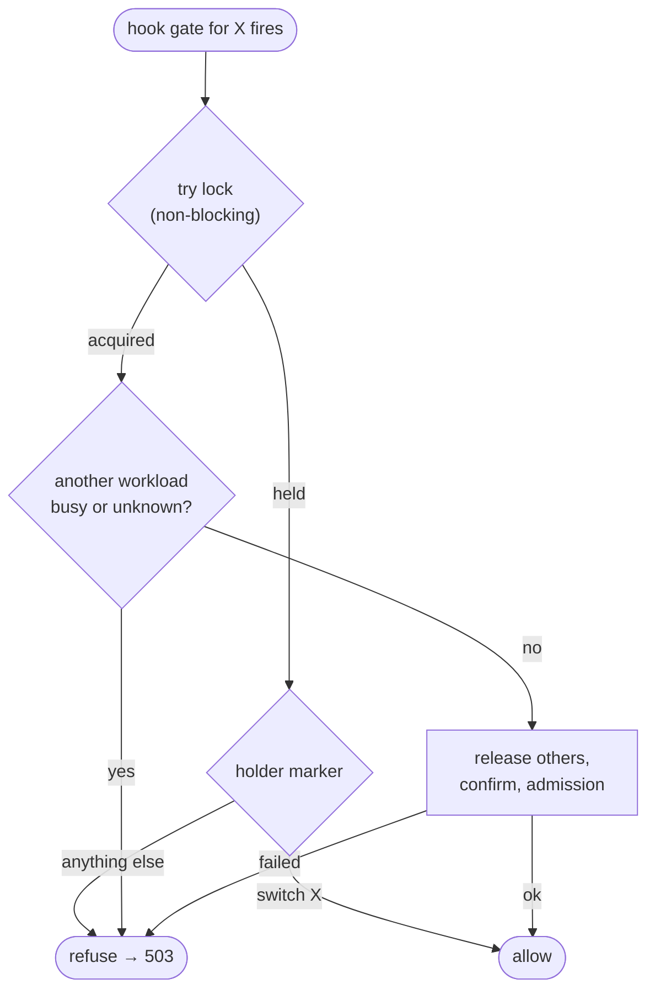

# vhotseat: turn gpu-workload into a generic, open-source GPU hotseat

Date: 2026-10-14 · Status: proposed

## 1. Goal

`gpu-workload` hands one GPU between two hard-coded servers, Strata and
ComfyUI. Most of what makes it work isn't specific to either:

- the GPU's owner is worked out live, with no state file;
- one lock, which records who holds it;
- `hold`, nested holds and bounded waits;
- the rule that **running work is never interrupted**.

**vhotseat** keeps that core and makes the workloads pluggable. Out of the box
it supports Strata, ComfyUI and Ollama. Through config or a small plugin it
covers anything that can say "am I busy", "drop your VRAM" and "may I load".

> **vhotseat** (v-hotseat: VRAM hotseat). Take turns on one GPU. Hot-seat
> multiplayer: one device, players take turns, nobody is kicked out mid-turn.

The name is free on PyPI, npm and GitHub (user/org and repo), checked
2026-10-14.

### Decisions so far

| Decision | Choice |
| --- | --- |
| Sharing model | **Exclusive**: one workload owns the GPU at a time. No VRAM budgets or co-residency in v1. |
| Third workload, to prove the abstraction | **Ollama**, gated by a reverse proxy |
| Strata | Public ([Niko1221/Strata](https://github.com/Niko1221/Strata)). Ships as a config example for the generic `http` driver; no special code. |
| Name | `vhotseat`: CLI, PyPI package and GitHub repo |
| Platforms | Linux first. Windows is designed for from day one (pluggable backends) and shipped in a later phase. |
| Config format | YAML |
| ComfyUI calling Strata (nested use) | **Not supported.** The intended direction is an agent on the LLM driving ComfyUI. For ComfyUI driving Strata, point users to [Comfyui-Strata-T8](https://github.com/T8mars/Comfyui-Strata-T8) (§6). |
| Repo | Continue in `wandering-vibe/gpu-workload` for now; move the history to its own repo (`git filter-repo`) before the public release |
| Licence | MIT |

### Non-goals (v1)

- Sharing one GPU between workloads at the same time (VRAM budgets, MIG, MPS).
- Multi-GPU scheduling. The lock is keyed by GPU index so this can come later.
- Swapping models inside one server. Ollama and llama-swap already do that;
  vhotseat arbitrates between servers.
- Interrupting or pre-empting work. Never.
- WSL2 mixed with native Windows (see §8.4).
- One workload's job calling another workload mid-job, e.g. a ComfyUI node
  that calls Strata (see §6).

## 2. Prior art and positioning

| Project | What it does | Gap vhotseat fills |
| --- | --- | --- |
| [llama-swap](https://github.com/mostlygeek/llama-swap) (~6k★) | Proxy that swaps between OpenAI-compatible LLM backends | LLM servers only, and it controls them. It doesn't take turns with non-LLM apps such as ComfyUI, and doesn't protect a running job. It could be a vhotseat workload. |
| Ollama's scheduler | Loads and evicts models inside Ollama | Only Ollama's own models |
| [T8mars/Comfyui-Strata-T8](https://github.com/T8mars/Comfyui-Strata-T8) | ComfyUI nodes that call Strata, with a same-GPU handoff around each node | ComfyUI drives and Strata is a subroutine. Unloads after every use. Other clients of Strata aren't covered. Tied to its own runtime protocol. |

**Pitch:** the servers stay as they are, and every client is covered: web UIs,
agents, curl and cron all go through the same gate. A running job is never
interrupted, and the GPU changes hands only when the other side actually
needs it.

### Lessons taken from Comfyui-Strata-T8

| Lesson | Where it lands |
| --- | --- |
| Fail closed: an incomplete status is never treated as idle | `busy` / `resident` may be `None` (unknown); the core treats unknown as busy (§4.1) |
| A real busy signal (`activity.in_flight`) | Optional `busy` in the driver; ask upstream Strata for `in_flight` (§10) |
| Admission check on free VRAM and RAM before loading | `admission.min_free_mib` / `min_free_ram_mib` (§4.3) |
| Wait for free VRAM to return to its baseline after a release | `confirm` falls back to the card's free VRAM baseline (§4.1 #7) |
| Escalate when a release can't be confirmed | `on_release_failure: restart` (§4.3) |
| Check the endpoint's identity | `identity` probe (§4.1 #5) |
| Key the lock by GPU, not by app | `gpu:<index>` lock (§5) |
| Unload after every use as an option | `release_policy: after-use` (§4.3) |
| ComfyUI Registry, CI, protocol versions, Windows | §9 phases 3–4 |

Their nodes and our guard **don't work together**: a Strata node runs inside a
ComfyUI job, so Strata's hook sees a running ComfyUI job and refuses. That's
out of scope (§6); the two projects cover opposite directions.

## 3. Architecture

### 3.1 Components

Layered top to bottom: a gate asks, the core decides, drivers act on the
workloads. Each workload's own clients keep talking to it as before; the gate
sits at the server's front door (hook, plugin) or in front of it (proxy).



Where each gate lives, for the three example workloads:



### 3.2 acquire(): one handover

ComfyUI job arrives while Strata holds the GPU.



### 3.3 Gate decision when the lock is held

Hook gates run inside the workload's own load, so they never block on the
lock. They read the holder marker instead (today's how-it-works §4.1 rule,
generalized).



The lock and the `acquire` algorithm are **not** extensible, because that's
where the safety rules live. Plugins describe workloads; they never change how
arbitration works.

### Modes become owners

| Today | vhotseat |
| --- | --- |
| `strata` / `comfy` / `conflict` | `owner: <name>` · `owner: none` (nothing resident) · `conflict: [a, b]` |

### CLI

```
vhotseat status [--json]
vhotseat switch <name> [--wait S] [--json]   # idempotent
vhotseat check  <name> [--json]              # exit 3 if not owner
vhotseat hold   <name> [--wait S] -- CMD...  # keep ownership until CMD exits
vhotseat run    <name> [--wait S] -- CMD...  # CMD *is* the workload (wrap gate)
vhotseat gate   <name>                       # entry for hook-style gates
vhotseat proxy  <name>                       # run a proxy gate (or all: vhotseat serve)
vhotseat doctor                              # check config, backends, gates installed
```

Exit codes stay the same: `0` ok · `1` failed or refused · `2` usage ·
`3` wrong owner.

## 4. Extension points

### 4.1 Driver contract: what vhotseat asks a workload

| # | Point | Strata | ComfyUI | Ollama |
| --- | --- | --- | --- | --- |
| 1 | **reachable** | `GET /health` → 200 | `GET /queue` → 200 | `GET /api/version` → 200 |
| 2 | **resident** | `/health` `$.loaded` | `/system_stats` `torch_vram_total` > `idle_vram_mib` | `/api/ps` `models` non-empty |
| 3 | **busy** | not exposed → learned from a 409 on release; later `in_flight` | `/queue` running + pending > 0 | proxy's in-flight count (`/_vhotseat/status`) |
| 4 | **vram_mib** | GPU backend: cgroup `strata.service` (Linux) / process tree (Windows) | `/system_stats` `torch_vram_total`; fallback to GPU backend | `/api/ps` sum of `size_vram` |
| 5 | **identity** | `/v1/models` model id | `/system_stats` `comfyui_version` | `/api/version` |
| 6 | **release(wait)** | `POST /unload?wait={wait}`; 409/`busy` → Busy; `release_always: true` | `POST /free {unload_models, free_memory}` (acts between jobs) | proxy drains, then `keep_alive: 0` for each model in `/api/ps` |
| 7 | **confirm** | vram → 0 | vram ≤ `idle_vram_mib` | `/api/ps` empty |
| 8 | **load** (optional) | `POST /load` (≤ 300 s) | none (lazy) | optional warm-up with `default_model` |
| 9 | **service** | `systemd --user strata` | `systemd --user comfyui` | `systemd ollama`, `OLLAMA_HOST=127.0.0.1:11435` |
| 10 | **hooks**: `before_release` / `after_load` | future: `/slots/0?action=save` / `restore` to keep the prefix cache | – | – |

Each probe returns `True` / `False` / `None` (unknown). **The core treats
unknown as busy and resident.** Today `_comfy_jobs()` returns 0 when `/queue`
can't be reached; that gets fixed along the way.

For **confirm**, if no workload-level check is configured, the core waits for
the card's free VRAM to return to within 256 MiB of what it was before the
other workload loaded (the baseline). This works on every platform and with
Docker.

### 4.2 Gates: how a workload asks for the GPU

Every gate ends in `Arbiter.acquire(name, wait)`.

| # | Point | Strata | ComfyUI | Ollama |
| --- | --- | --- | --- | --- |
| 11 | **kind** | `hook`: `before_load: ["vhotseat","gate","strata"]`, `before_load_strict: true` | `plugin`: custom node wraps `PromptExecutor.execute_async` | `proxy`: `:11434` → `:11435`; model routes gated, the rest passed through |
| 12 | **on_busy** | `refuse` (≤ 20 s inside Strata's 30 s hook limit) | `wait: 300`, then fail the job | `wait: 120` (request held open), then refuse |
| 13 | **busy reply** | Strata's 503 + `Retry-After` | `execution_error` "GPU busy, job not run" | 503 + `Retry-After`, Ollama-style `{"error": …}` |

The `wrap` gate (`vhotseat run <name> -- CMD`) is for plain processes such as
training scripts. CMD is resident and busy while it lives, and can't be
released.

### 4.3 Policies (config only)

| # | Point | Strata | ComfyUI | Ollama |
| --- | --- | --- | --- | --- |
| 14 | **release_policy** (`on-demand` · `after-use` · `idle:<s>`) | `on-demand` (+ Strata `lazy_load`) | `on-demand` | `on-demand` + `OLLAMA_KEEP_ALIVE=-1` |
| 15 | **admission** (`min_free_mib`, `min_free_ram_mib`) | 14000 | 0 | 0 or the largest model |
| 16 | **on_release_failure** (`fail` · `restart`) | `restart` | `restart` only with an empty queue | `restart` |

### 4.4 Machine-wide

| # | Point | v1 | Later |
| --- | --- | --- | --- |
| 18 | **GpuBackend**: card total/free, VRAM per process | `nvml` (pynvml), `nvidia-smi` fallback; per-process attributed by cgroup on Linux | Windows: PDH `GPU Process Memory` + process tree; AMD `amd-smi` |
| 19 | **ServiceBackend** | `systemd-user`, `systemd`, `none` | `docker`, `process` (start/stop/pid), Windows services / Job Objects |
| 20 | **EventSink** | `jsonl` (as today) | `command`, `webhook` |

### 4.5 How a workload plugs in (easiest first)

1. **Preset:** `driver: comfyui` or `driver: ollama`.
2. **`http`:** request + JSON-path + status-code rules in YAML (Strata).
3. **`command`:** one shell command per operation; exit code or stdout is the
   answer. Works with any language.
4. **Python:** a class registered under the `vhotseat.drivers` entry point.

### 4.6 Python interfaces

```python
@dataclass
class Status:
    reachable: bool
    resident: bool | None     # None = unknown → treated as resident
    busy: bool | None         # None = unknown → treated as busy
    vram_mib: int | None
    identity: str | None = None

class Workload(Protocol):
    name: str
    release_always: bool      # Strata: a load may be under way before VRAM shows
    def status(self) -> Status: ...
    def release(self, wait: float) -> None: ...   # raises Busy / ReleaseFailed; never interrupts
    def load(self, timeout: float) -> None: ...   # optional; NotImplemented = lazy
    def confirm_released(self, s: Status) -> bool: ...

class Gate(Protocol):
    def serve(self, arbiter: "Arbiter") -> None: ...

class GpuBackend(Protocol):
    def card(self) -> tuple[int, int]: ...                # total_mib, free_mib
    def usage_by(self, selector) -> int | None: ...       # None if not attributable (WDDM)

class ServiceBackend(Protocol):
    def is_active(self) -> bool: ...
    def start(self) -> None: ...
    def restart(self) -> None: ...

class EventSink(Protocol):
    def emit(self, event: dict) -> None: ...
```

## 5. Core algorithm

`acquire(X, wait)` keeps today's `to_strata` / `to_comfy` behaviour, written
once:

1. Take the lock for `gpu:<index>`. Mark the holder `switch X`, `hold X` or
   `run X`.
   - Hook gates only **try** the lock. If it's held, they read the holder
     marker: `switch X` → allow; anything else → refuse. This is
     today's §4.1 deadlock rule, generalized.
2. For every workload Y ≠ X that is resident or `release_always`:
   1. `busy` true or unknown → wait up to `wait`, polling, else raise Busy.
   2. `Y.release(wait)` → `Y.confirm_released`, or the baseline check, within
      the release timeout.
   3. On failure: `on_release_failure: restart` → restart Y's service and
      confirm again; otherwise raise.
3. Admission: card free VRAM ≥ `X.admission.min_free_mib` (and RAM), else
   raise.
4. If called from `switch`: `X.load()` when supported. Gates skip this; the
   workload loads itself.
5. Record the event. Release the lock, or keep it for `hold` and `run`.

`probe()` → `owner` = the single workload that's resident; `conflict` if
there's more than one; `none` if there are none.

## 6. Out of scope: one workload calling another mid-job

Example: a ComfyUI node that calls Strata while its job runs, as
[Comfyui-Strata-T8](https://github.com/T8mars/Comfyui-Strata-T8) does. The
ComfyUI job owns the GPU, so Strata's hook sees ComfyUI busy and refuses.
Waiting would deadlock, because the job is waiting on Strata.

**Not supported.** vhotseat is built for the opposite direction: an agent on
the LLM drives ComfyUI, and each side takes the GPU between steps. Users who
want ComfyUI to drive Strata should use Comfyui-Strata-T8, which handles the
handoff inside its nodes, and not install the vhotseat guard on that ComfyUI.

The README says so plainly. `vhotseat doctor` warns when it finds both the
guard and Comfyui-Strata-T8 with `same_gpu: true` installed.

If it's ever needed, the design sketched during planning was a lease token
created by the guard for each job, plus a `vhotseat borrow <name> --lease
TOKEN` that lets code inside that job lend the GPU to another workload and
take it back. One open problem was that ComfyUI's `/free` only acts between
jobs, so the lender's models would have to be unloaded from inside the job.

## 7. Ollama proxy gate

Why a proxy: vhotseat needs two things from every workload, and Ollama has
neither.

1. **A gate.** Something has to run *before* the workload loads a model, so
   vhotseat can free the GPU first or refuse. Strata has `before_load` and
   ComfyUI has custom nodes, but Ollama loads a model whenever a request names
   it, with no hook and no plugins. Without a gate, Ollama loads on top of a
   rendering ComfyUI: out of memory on Linux, or a silent spill into system
   RAM on Windows (§8.2).
2. **A busy signal.** Before releasing a workload, vhotseat must know it isn't
   mid-answer. Ollama's `/api/ps` lists loaded models but not in-flight
   requests.

A proxy in front of Ollama provides both: it calls `acquire("ollama")` before
forwarding, and it counts the requests it is forwarding. Nothing in Ollama or
its clients changes. The same proxy covers any server with an HTTP API and no
hook (llama-server, vLLM, LM Studio).

- Listens on `127.0.0.1:11434`; upstream is Ollama on `:11435`
  (`OLLAMA_HOST`). Existing clients don't change.
- **Gated routes** (they load a model): `/api/chat`, `/api/generate`,
  `/api/embed`, `/api/embeddings`, `/v1/chat/completions`, `/v1/completions`,
  `/v1/embeddings`. Everything else is passed through unchanged (`/api/tags`,
  `/api/pull`, `/api/ps`, …).
- **Fast path:** while Ollama owns the GPU and no switch is pending, skip the
  lock and forward. Ownership is cached in memory and invalidated through a
  "switch pending" flag in the lock file, read with a cheap `stat`. It must
  not run nvidia-smi on every request.
- **Busy signal:** the proxy counts in-flight requests, including streaming
  ones until the stream closes. It serves `/_vhotseat/status`
  `{in_flight, draining}`, which the Ollama driver reads.
- **Release:** set `draining` (new requests wait at the gate), wait for
  `in_flight == 0` within `wait`, then `keep_alive: 0` for every model in
  `/api/ps`, then confirm `/api/ps` is empty.
- **When another workload is busy:** hold the request open up to
  `on_busy.wait`, then 503 + `Retry-After`. Most Ollama clients handle a slow
  answer better than a 503.
- Streaming: pass bytes through without buffering (`httpx` / `aiohttp`).
  Measure the added latency (target < 1 ms on the fast path).
- **The same proxy works for any OpenAI-compatible server** (llama-server,
  vLLM, LM Studio, Strata without its hook) with `driver: http`. This is
  probably the largest group of users.

**To check:** does `keep_alive: 0` wait for in-flight requests in Ollama, or
can it cut a stream short? Draining makes this moot for traffic through the
proxy, but not for clients that talk to `:11435` directly. Document "don't do
that".

## 8. Windows

All three apps run natively on Windows. Strata via its portable bundle,
ComfyUI via its portable zip or Desktop, Ollama via its tray app. None runs as
a Windows service by default.

### 8.1 VRAM accounting

- On GeForce cards under WDDM, `nvidia-smi --query-compute-apps` and NVML
  report per-process `used_memory` as `[N/A]`. Only cards in TCC mode report
  it. Card totals (`memory.total`, `memory.free`) do work.
- Process names are `python.exe` / `ollama.exe` at install-specific paths.
- Desktop processes hold a varying 0.5–2 GB.

So on Windows the order is: **the workload's own figure** (Ollama `/api/ps`,
ComfyUI `/system_stats`) → **PDH `GPU Process Memory(pid_*)\Dedicated
Usage`** (what Task Manager uses; works for any vendor) summed over the
server's process tree with psutil → **baseline of card free VRAM**. The same
order is better on Linux too: no path matching, and it works with Docker.

### 8.2 Sysmem fallback

Since driver 536.40, the Windows driver spills CUDA allocations into shared
system RAM instead of running out of memory. Collisions don't crash; both
sides just run 5–20× slower. Therefore:

- admission checks are the real safety net on Windows;
- `vhotseat status` / `doctor` warn when `GPU Adapter Memory\Shared Usage`
  shows CUDA spilling;
- the docs recommend "CUDA – Sysmem Fallback Policy: Prefer No Sysmem
  Fallback" for the server executables.

### 8.3 Platform layer

| Area | Linux | Windows |
| --- | --- | --- |
| Lock | `fcntl.flock` | `msvcrt.locking` on the same file (holder text kept) |
| Service | systemd | `process` backend: start a `.bat`/exe detached inside a Job Object, track by PID; optional NSSM / `sc` |
| Restart | `systemctl restart` | terminate the Job Object, relaunch |
| `hold` signal forwarding | SIGINT/TERM/HUP | new process group + Job Object; Ctrl+Break |
| Paths | XDG | `%LOCALAPPDATA%\vhotseat` (`platformdirs`) |
| CLI | entry point | `vhotseat.exe` via pip entry point |

### 8.4 WSL2

Inside WSL, nvidia-smi sees the card but no processes, and native Windows
can't see WSL's file lock. Unsupported in v1. A later option is a lock served
over localhost HTTP by `vhotseat serve`.

## 9. Phases

Each phase ships on its own and leaves this machine working.

### Phase 0: refactor in place, behaviour identical

- Split `gpu-workload` into a package: `core` (arbiter, lock, events),
  `drivers/` (`strata_http`, `comfyui`), `gpu/nvidia_smi`, `service/systemd`.
- `to_strata` / `to_comfy` → `acquire()`; the hook → generic `gate`.
- Keep the `gpu-workload` CLI name and env vars as a compatibility shim.
  Strata's `before_load` and the guard keep working unchanged.
- Fix fail-open: an unreachable `/queue` means busy=unknown, not 0.
- **Tests:** fake HTTP servers for Strata and ComfyUI, a fake GPU backend.
  Cover every race in how-it-works §3 and every deadlock in §4 as scenarios.
  There are no tests today; this is the biggest gap before going public.
- **Done when:** the test suite passes, and the pi → ComfyUI → pi flow in
  how-it-works §2 works end to end on this machine.

### Phase 1: config and generic drivers

- `~/.config/vhotseat/config.yaml` (§11), validated by a schema; `vhotseat
  doctor`.
- `http` and `command` drivers. Strata moves to an `http` config with no code.
- `comfyui` preset uses `/system_stats` for VRAM instead of the 1500 MiB
  heuristic.
- `nvml` backend; cgroup attribution by systemd unit.
- Rename the CLI to `vhotseat`; `gpu-workload` stays as an alias for one
  release.
- Admission checks, `on_release_failure`, baseline confirm, identity.

### Phase 2: Ollama and the proxy gate

- `ollama` preset, proxy gate (§7), `vhotseat serve` (runs every proxy gate;
  a systemd unit is provided).
- Benchmark: proxy latency on the fast path; Strata → Ollama → ComfyUI →
  Strata handover chain.
- Example configs: llama-server, vLLM.

### Phase 3: open-source release (Linux)

- Until here, work continues in `wandering-vibe/gpu-workload/`. Now move it to
  a new repo `vhotseat` (MIT) with `git filter-repo --subdirectory-filter
  gpu-workload`, so its history comes along; leave a pointer behind.
- PyPI package; ComfyUI guard published to the ComfyUI Registry as
  `vhotseat-guard`.
- CI: lint, tests, Python 3.10–3.13.
- Docs: README (pitch + 5-minute quickstart for ComfyUI + Ollama), a
  generalized `how-it-works.md`, a driver-authoring guide, one example config
  per workload.
- Keep personal things out: pi skill, yuki-conductor specifics, `comfy-render`
  (stays here, or becomes its own small tool).

### Phase 4: Windows

- `msvcrt` lock, PDH GPU backend, `process` service backend with Job Objects,
  sysmem-fallback warning.
- Needs a Windows NVIDIA tester (T8's users are the natural pool) to confirm
  the WDDM `[N/A]` behaviour, the PDH counters and sysmem fallback.

## 10. Upstream asks

| Project | Ask | Why |
| --- | --- | --- |
| Strata | `in_flight` (and per-process VRAM) in `/health` or `/v1/status` | real busy signal instead of a 409 on release |
| Strata | document `/unload?wait` and `before_load` as a stable integration point | vhotseat's Strata gate depends on them |
| ComfyUI | a public pre-execute hook | the guard wraps a private method (`docs/comfyui-updates.md`) |
| Ollama | busy / in-flight in `/api/ps` | would let Ollama work without the proxy for status |

## 11. Example config

```yaml
gpu: {index: 0, backend: nvml}

workloads:
  strata:
    driver: http
    url: http://127.0.0.1:2335
    service: {systemd-user: strata}
    vram: {cgroup: strata.service}
    identity: {get: /v1/models, path: $.data[0].id}
    reachable: {get: /health}
    resident: {get: /health, path: $.loaded}
    release:
      post: /unload?wait={wait}
      always: true
      busy_when: {status: 409}
      ok_when: {path: $.status, in: [unloaded, not loaded]}
    confirm: {vram_at_most: 0}
    load: {post: /load, timeout: 300}
    gate: {kind: hook, on_busy: refuse, timeout: 20}
    admission: {min_free_mib: 14000}
    on_release_failure: restart

  comfy:
    driver: comfyui
    url: http://127.0.0.1:8188
    service: {systemd-user: comfyui}
    idle_vram_mib: 1500
    gate: {kind: plugin, on_busy: wait, timeout: 300}
    on_release_failure: restart

  ollama:
    driver: ollama
    upstream: http://127.0.0.1:11435
    service: {systemd: ollama}
    gate: {kind: proxy, listen: 127.0.0.1:11434, on_busy: wait, timeout: 120}
    on_release_failure: restart

events:
  - {jsonl: ~/.local/state/vhotseat/events.jsonl, keep: 500}
```

## 12. Open questions

1. **Daemon or no daemon?** Today it's a stateless CLI plus a file lock. The
   proxy gate (§7) needs a long-running process anyway (`vhotseat serve`).
   Should switches also go through it, or stay CLI + lock? Leaning: the lock
   stays the source of truth; `serve` is optional and only runs proxy gates.
2. **Ollama `keep_alive: 0` during a stream** (§7): does it wait for
   in-flight requests, or cut them short?
3. **Strata prefix-cache save/restore** across an engine restart (how-it-works
   §5.4): does a restored slot actually get reused? If so it becomes a
   `before_release` / `after_load` hook.

### Decided 2026-10-14

| Question | Decision |
| --- | --- |
| Config format | YAML |
| ComfyUI calling Strata mid-job (nested leases) | Not supported; see §6 |
| Repo | Stay in this repo; `git filter-repo` into `vhotseat` at phase 3 |
| Licence | MIT |
