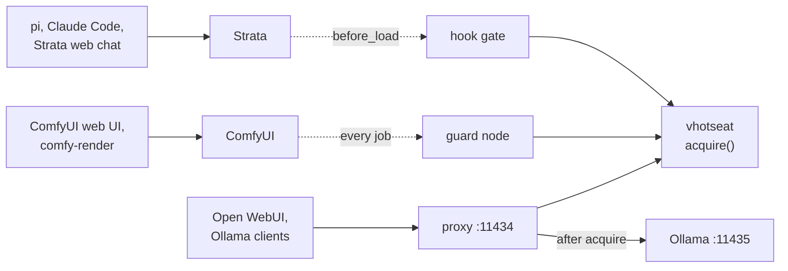
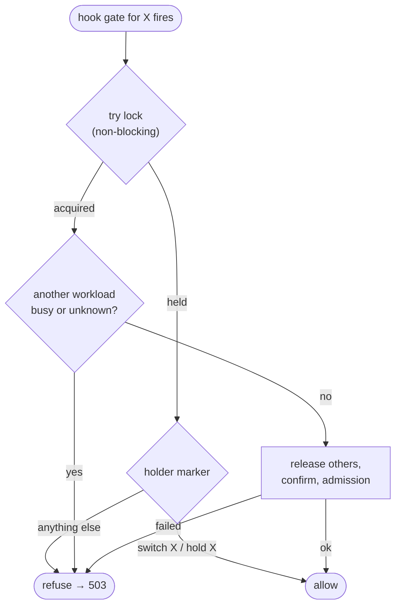

# vhotseat: turn gpu-workload into a generic, open-source GPU hotseat

Date: 2026-10-14 · Status: proposed

## 1. Goal

`gpu-workload` hands one GPU between two hard-coded servers, Strata and
ComfyUI. Most of what makes it work isn't specific to either:

- the GPU's owner is worked out live, with no state file;
- one lock, which records who holds it;
- `hold`, nested holds and bounded waits;
- the rule that **running work is never interrupted**.

**vhotseat** keeps that core and makes the workloads pluggable. Out of the box
it supports Strata, ComfyUI and Ollama. Through config or a small plugin it
covers anything that can say "am I busy", "drop your VRAM" and "may I load".

> **vhotseat** (v-hotseat: VRAM hotseat). Take turns on one GPU. Hot-seat
> multiplayer: one device, players take turns, nobody is kicked out mid-turn.

The name is free on PyPI, npm and GitHub (user/org and repo), checked
2026-10-14.

### Decisions so far

| Decision | Choice |
| --- | --- |
| Sharing model | **Exclusive**: one workload owns the GPU at a time. No VRAM budgets or co-residency in v1. |
| Third workload, to prove the abstraction | **Ollama**, gated by a reverse proxy |
| Strata | Public ([Niko1221/Strata](https://github.com/Niko1221/Strata)). Ships as a config example for the generic `http` driver; no special code. |
| Name | `vhotseat`: CLI, PyPI package and GitHub repo |
| Platforms | Linux first. Windows is designed for from day one (pluggable backends) and shipped in a later phase. |
| Config format | YAML |
| ComfyUI calling Strata (nested use) | **Not supported.** The intended direction is an agent on the LLM driving ComfyUI. For ComfyUI driving Strata, point users to [Comfyui-Strata-T8](https://github.com/T8mars/Comfyui-Strata-T8) (§6). |
| Repo | Continue in `wandering-vibe/gpu-workload` for now; move the history to its own repo (`git filter-repo`) before the public release |
| Licence | MIT |

### Non-goals (v1)

- Sharing one GPU between workloads at the same time (VRAM budgets, MIG, MPS).
- Multi-GPU scheduling. The lock is keyed by GPU index so this can come later.
- Swapping models inside one server. Ollama and llama-swap already do that;
  vhotseat arbitrates between servers.
- Interrupting or pre-empting work. Never.
- WSL2 mixed with native Windows (see §8.4).
- One workload's job calling another workload mid-job, e.g. a ComfyUI node
  that calls Strata (see §6).

## 2. Prior art and positioning

| Project | What it does | Gap vhotseat fills |
| --- | --- | --- |
| [llama-swap](https://github.com/mostlygeek/llama-swap) (~6k★) | Proxy that swaps between OpenAI-compatible LLM backends | LLM servers only, and it controls them. It doesn't take turns with non-LLM apps such as ComfyUI, and doesn't protect a running job. It could be a vhotseat workload. |
| Ollama's scheduler | Loads and evicts models inside Ollama | Only Ollama's own models |
| [T8mars/Comfyui-Strata-T8](https://github.com/T8mars/Comfyui-Strata-T8) | ComfyUI nodes that call Strata, with a same-GPU handoff around each node | ComfyUI drives and Strata is a subroutine. Unloads after every use. Other clients of Strata aren't covered. Tied to its own runtime protocol. |

**Pitch:** the servers stay as they are, and every client is covered: web UIs,
agents, curl and cron all go through the same gate. A running job is never
interrupted, and the GPU changes hands only when the other side actually
needs it.

### Lessons taken from Comfyui-Strata-T8

| Lesson | Where it lands |
| --- | --- |
| Fail closed: an incomplete status is never treated as idle | `busy` / `resident` may be `None` (unknown); the core treats unknown as busy (§4.1) |
| A real busy signal (`activity.in_flight`) | Optional `busy` in the driver; ask upstream Strata for `in_flight` (§10) |
| Admission check on free VRAM and RAM before loading | `admission.min_free_mib` / `min_free_ram_mib` (§4.3) |
| Wait for free VRAM to return to its baseline after a release | `confirm` falls back to the card's free VRAM baseline (§4.1 #7) |
| Escalate when a release can't be confirmed | `on_release_failure: restart` (§4.3) |
| Check the endpoint's identity | `vhotseat doctor` check (§4.1 #5) |
| Key the lock by GPU, not by app | `gpu:<index>` lock (§5) |
| Unload after every use as an option | Not adopted; on-demand only (§4.3 #14, Appendix A) |
| ComfyUI Registry, CI, protocol versions, Windows | §9 phases 3–4 |

Their nodes and our guard **don't work together**: a Strata node runs inside a
ComfyUI job, so Strata's hook sees a running ComfyUI job and refuses. That's
out of scope (§6); the two projects cover opposite directions.

## 3. Architecture

### 3.1 Components

Layered top to bottom: a gate asks, the core decides, drivers act on the
workloads. Each workload's own clients keep talking to it as before; the gate
sits at the server's front door (hook, plugin) or in front of it (proxy).


Where each gate lives, for the three example workloads:



### 3.2 acquire(): one handover

ComfyUI job arrives while Strata holds the GPU.


### 3.3 Gate decision when the lock is held

Hook gates run inside the workload's own load, so they never block on the
lock. They read the holder marker instead (today's how-it-works §4.1 rule,
generalized).



The lock and the `acquire` algorithm are **not** extensible, because that's
where the safety rules live. Plugins describe workloads; they never change how
arbitration works.

### Modes become owners

| Today | vhotseat |
| --- | --- |
| `strata` / `comfy` / `conflict` | `owner: <name>` · `owner: none` (nothing resident) · `conflict: [a, b]` |

### CLI

```
vhotseat status [--json]                     # who owns the GPU, what each workload holds, last event
vhotseat switch <name>|none [--wait S] [--json]   # take the GPU for <name> (or free it); idempotent
vhotseat hold   <name> [--wait S] -- CMD...  # take it and keep it until CMD exits
vhotseat gate   <name>                       # entry point for hook gates (Strata's before_load)
vhotseat serve  [<name>...]                  # run the proxy gates in the config
vhotseat doctor                              # check config, backends and that every gate is installed
```

Exit codes stay the same: `0` ok · `1` failed or refused · `2` usage.
`hold` exits with CMD's own code once CMD has started.

Compared with the first draft, `check` and `run` are gone and `proxy` is
folded into `serve`; `switch none` is new. Appendix A gives the reasons.

## 4. Extension points

Each point below has a one-line description, how the three example workloads
fill it, and a **v1** verdict from the self-review in Appendix A:
**core** (required), **optional** (a default exists; a workload may override
it), **merged** or **cut** (not in v1).

### 4.1 Driver contract: what vhotseat asks a workload

A driver answers questions about one workload and performs the one action
vhotseat needs from it: dropping its VRAM.

| # | Point | What it is | Strata | ComfyUI | Ollama | v1 |
| --- | --- | --- | --- | --- | --- | --- |
| 1 | **reachable** | Whether the workload's API answered at all. Separates "stopped/down" from "up but idle". | the `/health` request answered | the `/queue` request answered | the `/api/ps` request answered | merged into the status probe; not configured separately |
| 2 | **resident** | Whether it holds models in VRAM right now. Decides who owns the GPU. | `/health` `$.loaded` | `torch_vram_total` from `/system_stats` > `idle_vram_mib` | `/api/ps` `models` non-empty | core |
| 3 | **busy** | Whether it is doing work that must not be interrupted. The basis of "never interrupt". | not exposed; a 409 on release says it; later `in_flight` | `/queue` running + pending > 0 | proxy's in-flight count (`/_vhotseat/status`) | core (may be "learned from release") |
| 4 | **vram_mib** | How much VRAM it holds. Used to confirm a release, show status, and catch a process that holds VRAM while its API is down. | GPU backend: cgroup `strata.service` | `/system_stats` `torch_vram_total`; GPU backend as fallback | `/api/ps` sum of `size_vram` | optional (GPU backend attribution by default) |
| 5 | **identity** | Proof that the server on the port is the one configured. | `/v1/models` id | `/system_stats` version | `/api/version` | cut from runtime; a `doctor` check |
| 6 | **release(wait)** | Ask it to drop its VRAM without interrupting work, waiting up to `wait` for work to finish. | `POST /unload?wait=N`; 409/`busy` → Busy; `release_always` | `POST /free {unload_models, free_memory}` | proxy drains, then `keep_alive: 0` per model | core |
| 7 | **confirm** | Check the VRAM is actually gone, since release calls return before it is. | vram → 0 | vram ≤ `idle_vram_mib` | `/api/ps` empty | core (card-baseline default) |
| 8 | **load** | Load ahead of the first request, so `switch X` leaves X warm. Gates never call it. | `POST /load` | – (lazy) | optional warm-up of `default_model` | optional |
| 9 | **service** | Which service unit or process runs it, so vhotseat can start a stopped one and restart a stuck one. | `systemd --user strata` | `systemd --user comfyui` | `systemd ollama` | optional (default `none`) |
| 10 | **before_release / after_load hooks** | Per-workload actions around a handover. | (would save/restore the prefix cache) | – | – | cut until open question 3 is answered |

Each probe answers `True` / `False` / `None` (unknown). **The core treats
unknown as busy and resident.** Today `_comfy_jobs()` returns 0 when `/queue`
can't be reached; that gets fixed along the way.

For **confirm**, if no workload-level check is configured, the core waits for
the card's free VRAM to return to within 256 MiB of what it was before the
other workload loaded (the baseline). This works on every platform and with
Docker.

### 4.2 Gates: how a workload asks for the GPU

A gate is the code that runs *before* a workload touches the GPU and calls
`Arbiter.acquire(name, wait)`. Without one, a workload can load on top of
another; the gate is what makes vhotseat a guarantee rather than a
convention.

| # | Point | What it is | Strata | ComfyUI | Ollama | v1 |
| --- | --- | --- | --- | --- | --- | --- |
| 11 | **kind** | Where the gate runs: `hook` (the server runs a command before loading), `plugin` (code inside the server), `proxy` (vhotseat in front of the server's API), `hold` (a CLI wrapper around a command). | `hook`: `before_load: ["vhotseat","gate","strata"]`, `before_load_strict: true` | `plugin`: guard node wraps `PromptExecutor.execute_async` | `proxy`: `:11434` → `:11435`; model routes gated | core. `wrap` merged into `hold` |
| 12 | **on_busy** | What the gate does while another workload is busy: refuse now, or wait up to N seconds and then refuse. | `refuse` (Strata's hook limit is 30 s) | `wait: 300`, then fail the job | `wait: 120`, request held open | optional (default set per kind) |
| 13 | **busy reply** | How a refusal reaches the user. | Strata's 503 + `Retry-After` | `execution_error` "GPU busy, job not run" | 503 + `Retry-After`, `{"error": …}` | cut as a config point; fixed by each gate kind |

A process that isn't a server (a training script, a one-off CUDA tool) is a
workload with no driver ops, gated with `hold`: `vhotseat hold train --
python train.py`. While CMD runs, the lock is held, so every other gate waits
or refuses.

### 4.3 Policies (config only)

Knobs that change *when* or *how strictly* the core acts, with no code.

| # | Point | What it is | Strata | ComfyUI | Ollama | v1 |
| --- | --- | --- | --- | --- | --- | --- |
| 14 | **release_policy** | When a workload gives the GPU up: `on-demand` (only when someone else asks), `after-use`, or `idle:<s>`. | on-demand | on-demand | on-demand | cut; `on-demand` only. Use each server's own idle unload, or `switch none` |
| 15 | **admission** | Free VRAM (and RAM) required before a workload may load. | `min_free_mib: 14000` | 0 | 0 | optional (default 0); recommended on Windows |
| 16 | **on_release_failure** | What to do when a release isn't confirmed: `fail`, or `restart` the service, only if it isn't busy. | `restart` | `restart` | `restart` | optional (default `fail`) |

### 4.4 Machine-wide

One per install, not per workload.

| # | Point | What it is | v1 | Later |
| --- | --- | --- | --- | --- |
| 18 | **GpuBackend** | Reads the card's total/free VRAM and attributes VRAM to processes. | core: `nvml`, `nvidia-smi` fallback; cgroup attribution on Linux | Windows PDH + process tree; AMD `amd-smi` |
| 19 | **ServiceBackend** | Starts, checks and restarts the process behind a workload (#9). | optional: `systemd-user`, `systemd`, `none` | `docker`, `process` (Windows Job Objects) |
| 20 | **EventSink** | Where decisions are recorded. | fixed `jsonl`, not pluggable | `command`, `webhook` if anyone asks |

(#17, nested leases, was removed with §6.)

### 4.5 How a workload plugs in

1. **Preset:** `driver: comfyui` or `driver: ollama`. v1.
2. **`http`:** request + JSON-path + status-code rules in YAML (Strata,
   llama-server, vLLM). v1.
3. **Python:** a class registered under the `vhotseat.drivers` entry point.
   v1, since the presets are built this way anyway.
4. **`command`:** one shell command per operation. Deferred: every GPU server
   in view has an HTTP API, and a non-server process uses `hold`.

### 4.6 Python interfaces

```python
@dataclass
class Status:
    reachable: bool
    resident: bool | None     # None = unknown → treated as resident
    busy: bool | None         # None = unknown → treated as busy
    vram_mib: int | None

class Workload(Protocol):
    name: str
    release_always: bool      # Strata: a load may be under way before VRAM shows
    def status(self) -> Status: ...
    def release(self, wait: float) -> None: ...   # raises Busy / ReleaseFailed; never interrupts
    def load(self, timeout: float) -> None: ...   # optional; NotImplemented = lazy
    def confirm_released(self, s: Status) -> bool: ...

class Gate(Protocol):
    def serve(self, arbiter: "Arbiter") -> None: ...

class GpuBackend(Protocol):
    def card(self) -> tuple[int, int]: ...                # total_mib, free_mib
    def usage_by(self, selector) -> int | None: ...       # None if not attributable (WDDM)

class ServiceBackend(Protocol):
    def is_active(self) -> bool: ...
    def start(self) -> None: ...
    def restart(self) -> None: ...

```

## 5. Core algorithm

`acquire(X, wait)` keeps today's `to_strata` / `to_comfy` behaviour, written
once:

1. Take the lock for `gpu:<index>`. Mark the holder `switch X` or `hold X`.
   - **Same target, no wait:** if the lock is held and the marker says
     `switch X` or `hold X`, a gate for X proceeds without taking the lock.
     For hook gates this is today's deadlock rule (how-it-works §4.1),
     generalized. It also fixes a bug in today's code: a ComfyUI job started
     during `hold comfy` blocks in the guard on the hold's lock until the
     guard's 420 s timeout, while the held script waits for that job.
   - Hook gates only **try** the lock; for any other holder they refuse.
     Other gates wait for it (up to `wait`).
2. For every workload Y ≠ X that is resident or `release_always`:
   1. `busy` true or unknown → wait up to `wait`, polling, else raise Busy.
   2. `Y.release(wait)` → `Y.confirm_released`, or the baseline check, within
      the release timeout.
   3. On failure: `on_release_failure: restart` → restart Y's service and
      confirm again; otherwise raise.
3. Admission: card free VRAM ≥ `X.admission.min_free_mib` (and RAM), else
   raise.
4. If called from `switch`: `X.load()` when supported. Gates skip this; the
   workload loads itself. `switch none` stops after step 2.
5. Record the event. Release the lock, or keep it for `hold`.

`probe()` → `owner` = the single workload that's resident, or the `hold`
holder; `conflict` if there's more than one; `none` if there are none.

## 6. Out of scope: one workload calling another mid-job

Example: a ComfyUI node that calls Strata while its job runs, as
[Comfyui-Strata-T8](https://github.com/T8mars/Comfyui-Strata-T8) does. The
ComfyUI job owns the GPU, so Strata's hook sees ComfyUI busy and refuses.
Waiting would deadlock, because the job is waiting on Strata.

**Not supported.** vhotseat is built for the opposite direction: an agent on
the LLM drives ComfyUI, and each side takes the GPU between steps. Users who
want ComfyUI to drive Strata should use Comfyui-Strata-T8, which handles the
handoff inside its nodes, and not install the vhotseat guard on that ComfyUI.

The README says so plainly. `vhotseat doctor` warns when it finds both the
guard and Comfyui-Strata-T8 with `same_gpu: true` installed.

If it's ever needed, the design sketched during planning was a lease token
created by the guard for each job, plus a `vhotseat borrow <name> --lease
TOKEN` that lets code inside that job lend the GPU to another workload and
take it back. One open problem was that ComfyUI's `/free` only acts between
jobs, so the lender's models would have to be unloaded from inside the job.

## 7. Ollama proxy gate

Why a proxy: vhotseat needs two things from every workload, and Ollama has
neither.

1. **A gate.** Something has to run *before* the workload loads a model, so
   vhotseat can free the GPU first or refuse. Strata has `before_load` and
   ComfyUI has custom nodes, but Ollama loads a model whenever a request names
   it, with no hook and no plugins. Without a gate, Ollama loads on top of a
   rendering ComfyUI: out of memory on Linux, or a silent spill into system
   RAM on Windows (§8.2).
2. **A busy signal.** Before releasing a workload, vhotseat must know it isn't
   mid-answer. Ollama's `/api/ps` lists loaded models but not in-flight
   requests.

A proxy in front of Ollama provides both: it calls `acquire("ollama")` before
forwarding, and it counts the requests it is forwarding. Nothing in Ollama or
its clients changes. The same proxy covers any server with an HTTP API and no
hook (llama-server, vLLM, LM Studio).

- Listens on `127.0.0.1:11434`; upstream is Ollama on `:11435`
  (`OLLAMA_HOST`). Existing clients don't change.
- **Gated routes** (they load a model): `/api/chat`, `/api/generate`,
  `/api/embed`, `/api/embeddings`, `/v1/chat/completions`, `/v1/completions`,
  `/v1/embeddings`. Everything else is passed through unchanged (`/api/tags`,
  `/api/pull`, `/api/ps`, …).
- **Fast path:** while Ollama owns the GPU and no switch is pending, skip the
  lock and forward. Ownership is cached in memory and invalidated through a
  "switch pending" flag in the lock file, read with a cheap `stat`. It must
  not run nvidia-smi on every request.
- **Busy signal:** the proxy counts in-flight requests, including streaming
  ones until the stream closes. It serves `/_vhotseat/status`
  `{in_flight, draining}`, which the Ollama driver reads.
- **Release:** set `draining` (new requests wait at the gate), wait for
  `in_flight == 0` within `wait`, then `keep_alive: 0` for every model in
  `/api/ps`, then confirm `/api/ps` is empty.
- **When another workload is busy:** hold the request open up to
  `on_busy.wait`, then 503 + `Retry-After`. Most Ollama clients handle a slow
  answer better than a 503.
- Streaming: pass bytes through without buffering (`httpx` / `aiohttp`).
  Measure the added latency (target < 1 ms on the fast path).
- **The same proxy works for any OpenAI-compatible server** (llama-server,
  vLLM, LM Studio, Strata without its hook) with `driver: http`. This is
  probably the largest group of users.

**To check:** does `keep_alive: 0` wait for in-flight requests in Ollama, or
can it cut a stream short? Draining makes this moot for traffic through the
proxy, but not for clients that talk to `:11435` directly. Document "don't do
that".

## 8. Windows

All three apps run natively on Windows. Strata via its portable bundle,
ComfyUI via its portable zip or Desktop, Ollama via its tray app. None runs as
a Windows service by default.

### 8.1 VRAM accounting

- On GeForce cards under WDDM, `nvidia-smi --query-compute-apps` and NVML
  report per-process `used_memory` as `[N/A]`. Only cards in TCC mode report
  it. Card totals (`memory.total`, `memory.free`) do work.
- Process names are `python.exe` / `ollama.exe` at install-specific paths.
- Desktop processes hold a varying 0.5–2 GB.

So on Windows the order is: **the workload's own figure** (Ollama `/api/ps`,
ComfyUI `/system_stats`) → **PDH `GPU Process Memory(pid_*)\Dedicated
Usage`** (what Task Manager uses; works for any vendor) summed over the
server's process tree with psutil → **baseline of card free VRAM**. The same
order is better on Linux too: no path matching, and it works with Docker.

### 8.2 Sysmem fallback

Since driver 536.40, the Windows driver spills CUDA allocations into shared
system RAM instead of running out of memory. Collisions don't crash; both
sides just run 5–20× slower. Therefore:

- admission checks are the real safety net on Windows;
- `vhotseat status` / `doctor` warn when `GPU Adapter Memory\Shared Usage`
  shows CUDA spilling;
- the docs recommend "CUDA – Sysmem Fallback Policy: Prefer No Sysmem
  Fallback" for the server executables.

### 8.3 Platform layer

| Area | Linux | Windows |
| --- | --- | --- |
| Lock | `fcntl.flock` | `msvcrt.locking` on the same file (holder text kept) |
| Service | systemd | `process` backend: start a `.bat`/exe detached inside a Job Object, track by PID; optional NSSM / `sc` |
| Restart | `systemctl restart` | terminate the Job Object, relaunch |
| `hold` signal forwarding | SIGINT/TERM/HUP | new process group + Job Object; Ctrl+Break |
| Paths | XDG | `%LOCALAPPDATA%\vhotseat` (`platformdirs`) |
| CLI | entry point | `vhotseat.exe` via pip entry point |

### 8.4 WSL2

Inside WSL, nvidia-smi sees the card but no processes, and native Windows
can't see WSL's file lock. Unsupported in v1. A later option is a lock served
over localhost HTTP by `vhotseat serve`.

## 9. Phases

Each phase ships on its own and leaves this machine working.

### Phase 0: refactor in place, behaviour identical

- Split `gpu-workload` into a package: `core` (arbiter, lock, events),
  `drivers/` (`strata_http`, `comfyui`), `gpu/nvidia_smi`, `service/systemd`.
- `to_strata` / `to_comfy` → `acquire()`; the hook → generic `gate`.
- Fix the `hold` + guard lock wait (§5 step 1).
- Keep the `gpu-workload` CLI name and env vars as a compatibility shim.
  Strata's `before_load` and the guard keep working unchanged.
- Fix fail-open: an unreachable `/queue` means busy=unknown, not 0.
- **Tests:** fake HTTP servers for Strata and ComfyUI, a fake GPU backend.
  Cover every race in how-it-works §3 and every deadlock in §4 as scenarios.
  There are no tests today; this is the biggest gap before going public.
- **Done when:** the test suite passes, and the pi → ComfyUI → pi flow in
  how-it-works §2 works end to end on this machine.

### Phase 1: config and generic drivers

- `~/.config/vhotseat/config.yaml` (§11), validated by a schema; `vhotseat
  doctor`.
- `http` driver. Strata moves to an `http` config with no code.
- `comfyui` preset uses `/system_stats` for VRAM instead of the 1500 MiB
  heuristic.
- `nvml` backend; cgroup attribution by systemd unit.
- Rename the CLI to `vhotseat`; `gpu-workload` stays as an alias for one
  release.
- Admission checks, `on_release_failure`, baseline confirm, `switch none`.

### Phase 2: Ollama and the proxy gate

- `ollama` preset, proxy gate (§7), `vhotseat serve` (runs every proxy gate;
  a systemd unit is provided).
- Benchmark: proxy latency on the fast path; Strata → Ollama → ComfyUI →
  Strata handover chain.
- Example configs: llama-server, vLLM.

### Phase 3: open-source release (Linux)

- Until here, work continues in `wandering-vibe/gpu-workload/`. Now move it to
  a new repo `vhotseat` (MIT) with `git filter-repo --subdirectory-filter
  gpu-workload`, so its history comes along; leave a pointer behind.
- PyPI package; ComfyUI guard published to the ComfyUI Registry as
  `vhotseat-guard`.
- CI: lint, tests, Python 3.10–3.13.
- Docs: README (pitch + 5-minute quickstart for ComfyUI + Ollama), a
  generalized `how-it-works.md`, a driver-authoring guide, one example config
  per workload.
- Keep personal things out: pi skill, yuki-conductor specifics, `comfy-render`
  (stays here, or becomes its own small tool).

### Phase 4: Windows

- `msvcrt` lock, PDH GPU backend, `process` service backend with Job Objects,
  sysmem-fallback warning.
- Needs a Windows NVIDIA tester (T8's users are the natural pool) to confirm
  the WDDM `[N/A]` behaviour, the PDH counters and sysmem fallback.

## 10. Upstream asks

| Project | Ask | Why |
| --- | --- | --- |
| Strata | `in_flight` (and per-process VRAM) in `/health` or `/v1/status` | real busy signal instead of a 409 on release |
| Strata | document `/unload?wait` and `before_load` as a stable integration point | vhotseat's Strata gate depends on them |
| ComfyUI | a public pre-execute hook | the guard wraps a private method (`docs/comfyui-updates.md`) |
| Ollama | busy / in-flight in `/api/ps` | would let Ollama work without the proxy for status |

## 11. Example config

```yaml
gpu: {index: 0, backend: nvml}

workloads:
  strata:
    driver: http
    url: http://127.0.0.1:2335
    service: {systemd-user: strata}
    vram: {cgroup: strata.service}
    resident: {get: /health, path: $.loaded}
    release:
      post: /unload?wait={wait}
      always: true
      busy_when: {status: 409}
      ok_when: {path: $.status, in: [unloaded, not loaded]}
    confirm: {vram_at_most: 0}
    load: {post: /load, timeout: 300}
    gate: {kind: hook, on_busy: refuse, timeout: 20}
    admission: {min_free_mib: 14000}
    on_release_failure: restart

  comfy:
    driver: comfyui
    url: http://127.0.0.1:8188
    service: {systemd-user: comfyui}
    idle_vram_mib: 1500
    gate: {kind: plugin, on_busy: wait, timeout: 300}
    on_release_failure: restart

  ollama:
    driver: ollama
    upstream: http://127.0.0.1:11435
    service: {systemd: ollama}
    gate: {kind: proxy, listen: 127.0.0.1:11434, on_busy: wait, timeout: 120}
    on_release_failure: restart

events: {keep: 500}   # ~/.local/state/vhotseat/events.jsonl
```

## 12. Open questions

1. **Daemon or no daemon?** Today it's a stateless CLI plus a file lock. The
   proxy gate (§7) needs a long-running process anyway (`vhotseat serve`).
   Should switches also go through it, or stay CLI + lock? Leaning: the lock
   stays the source of truth; `serve` is optional and only runs proxy gates.
2. **Ollama `keep_alive: 0` during a stream** (§7): does it wait for
   in-flight requests, or cut them short?
3. **Strata prefix-cache save/restore** across an engine restart (how-it-works
   §5.4): does a restored slot actually get reused? If so it becomes a
   `before_release` / `after_load` hook.

### Decided 2026-10-14

| Question | Decision |
| --- | --- |
| Config format | YAML |
| ComfyUI calling Strata mid-job (nested leases) | Not supported; see §6 |
| Repo | Stay in this repo; `git filter-repo` into `vhotseat` at phase 3 |
| Licence | MIT |

## Appendix A: self-review of the CLI and extension points

For each command and extension point: is it really needed, and what breaks or
goes missing without it? The test for "needed": would a v1 user, or one of the
three example workloads, hit a safety hole, a deadlock or a dead end without
it? Anything that only adds convenience or anticipates a future user is cut or
deferred. It's easier to add a point later than to remove a documented one.

Usage data from this machine (`events.jsonl`, 2026-10-12 to 2026-10-14):
152 Strata hook decisions, 103 switches (65 of them from `conflict`, i.e. the
ComfyUI guard taking the GPU from a loaded Strata), 3 holds (all tests), and no
uses of `check` outside the docs.

### A.1 CLI

| Command | Verdict | Why it's needed | Without it |
| --- | --- | --- | --- |
| `status` | **keep** | The only way to see who owns the GPU, what each workload holds, and the last decision. It's the first thing anyone runs when a job is refused. `--json` feeds scripts and dashboards. | Debugging means reading three APIs, nvidia-smi and the event log by hand. |
| `switch <name>` | **keep** | Every gate other than the hook calls it: the ComfyUI guard runs `switch comfy --wait 300` before every job (65 of 103 switches here). By hand, it pre-warms a workload (`switch strata` loads the model) or moves the GPU on purpose. | Gates would need an in-process API in every language, and users couldn't move the GPU themselves. |
| `switch none` | **add** | Releases every workload without choosing a new owner: freeing the card for a game or a one-off tool, or an "unload at night" cron. This replaces the `release_policy` knob (#14). | The only way to empty the GPU would be switching to some workload, which loads that workload. |
| `hold <name> -- CMD` | **keep** | Two jobs: (1) keeps the GPU through a batch whose queue may go empty between jobs, so unrelated traffic can't split it (how-it-works §3.4); (2) gates a plain process that has no server, such as a training script. | (1) A multi-step render script loses the GPU between steps and pays two handovers each time. (2) A training run has no gate, so a Strata request loads on top of it. |
| `gate <name>` | **keep** | The command a hook gate runs (Strata's `before_load`). It's the only CLI entry that tries the lock without waiting, so it can't deadlock against the switch that triggered the load. | Strata has no gate, so any request would load it on top of a ComfyUI render. |
| `serve [<name>...]` | **keep, absorbs `proxy`** | Runs the proxy gates: the long-running process the Ollama gate needs. A separate `proxy <name>` adds nothing; `serve ollama` runs one. | No way to run a proxy gate, so Ollama and every hookless server is ungated. |
| `doctor` | **keep** | Gates live *outside* vhotseat: a line in Strata's config, a symlink in ComfyUI's `custom_nodes`, a moved Ollama port. If one is missing, nothing fails; the guarantee silently stops holding. `doctor` checks each gate is installed and reachable, the config is valid, the GPU backend works, and that each server is the one configured (#5). | A missing gate is found by an out-of-memory crash, or on Windows by a 10× slowdown with no error (§8.2). |
| `check <name>` | **cut** | Was "exit 0 if X owns the GPU, 3 otherwise", for scripts. Nothing calls it, and it's racy: ownership can change between the check and the work. The right tool is `switch` (take it) or `hold` (take and keep it). | A script that only wants to know uses `status --json`. Exit code 3 goes away with it. |
| `run <name> -- CMD` | **merged into `hold`** | Was "CMD *is* the workload". That's `hold` on a workload with no driver ops: same lock, same lifetime, same refusal of other gates. | Nothing; one command fewer to explain. |

### A.2 Driver contract (§4.1)

| # | Point | Verdict | Why it's needed | Without it |
| --- | --- | --- | --- | --- |
| 1 | reachable | **merge into status** | Needed: "API down" must not be read as "idle". But it doesn't need its own config entry; the status probe either answers or doesn't, and "no answer" makes `resident`/`busy` unknown. | As a separate point: duplicate config with no effect. Without the distinction at all: today's fail-open bug, an unreachable ComfyUI counted as 0 jobs. |
| 2 | resident | **core** | Defines ownership (`probe()`), and decides which workloads `acquire` must release. | vhotseat would release every workload on every switch, or never know there's a conflict. |
| 3 | busy | **core** | It's what "never interrupt work" rests on: the gate waits or refuses while another workload is busy. A driver may declare "busy is learned from release" (Strata today: a 409 from `/unload`). | Gates would release workloads mid-job. ComfyUI's `/free` would be queued behind the render while the gate waited, and Ollama would drop a model mid-stream. |
| 4 | vram_mib | **optional** | Used three ways: (a) confirming a release; (b) catching a process that holds VRAM while its service or API is down (today: "a Strata process holds VRAM but strata.service is stopped"); (c) `status` output. The default is the GPU backend's per-process attribution, so a driver only overrides it when the server knows better (Ollama, ComfyUI). | Without any attribution: (b) is lost, which is a real hole, since a crashed-but-resident server would look free. With only the default: fine on Linux, blind on Windows (§8.1). That's why the override exists. |
| 5 | identity | **cut from runtime, keep in `doctor`** | Protects against the configured port being served by something else (a second ComfyUI, an old Ollama). That's a setup mistake, found once, not something that changes per switch. | At runtime, nothing: a wrong server would fail its other probes anyway. As a `doctor` check it catches the mistake early. |
| 6 | release(wait) | **core** | The one action vhotseat needs from a workload. | There's nothing to arbitrate with. |
| 7 | confirm | **core, with a default** | Release calls return before the VRAM is free (ComfyUI's `/free` is deferred; Strata's engine takes a moment to exit; the TTS Audio Suite leak kept 2 GB after `/free` reported success). The default, waiting for the card's free VRAM to return to its baseline, needs no driver code. | Loading straight after release would collide with VRAM still being freed: an out-of-memory error, or a refusal from Strata's own `min_free_vram_mib`. |
| 8 | load | **optional** | Only `switch X` calls it, to leave X warm (`switch strata` → model loaded, first answer immediate). Gates never call it; each workload loads itself. | `switch strata` would leave Strata cold, and the first request would pay the 26–68 s load. Correctness is unaffected. |
| 9 | service | **optional, default `none`** | Two uses: starting a stopped workload during `switch`, and `on_release_failure: restart`. | Users would start services themselves; a stuck release would need a manual restart. Neither is a safety problem. |
| 10 | before_release / after_load | **cut** | Its only candidate is Strata's prefix-cache save/restore, and whether that works is open question 3. A general hook interface designed for one unproven use is likely to be wrong. | Nothing today. If the experiment works, add it then, shaped by the real use. |

### A.3 Gates (§4.2)

| # | Point | Verdict | Why it's needed | Without it |
| --- | --- | --- | --- | --- |
| 11 | kind: `hook` | **core** | The gate for servers that run a command before loading (Strata). Zero extra processes; refusals reach clients as the server's own 503. | Strata would need a proxy in front of it. That works, but adds a hop to every token stream and a process to keep running. |
| 11 | kind: `plugin` | **core** | The gate for servers that load inside their own job runner (ComfyUI). Nothing outside the server sees "a job is about to load models". | A proxy in front of ComfyUI's `/prompt` would only see *submission*, not *start*. A queued job could start long after the gate approved it, by which time Strata may have reloaded. |
| 11 | kind: `proxy` | **core** | The only gate for servers with no hook and no plugin system (Ollama, llama-server, vLLM, LM Studio): most of the open-source audience. It also provides Ollama's missing busy signal (#3). | vhotseat would only work with servers that have a hook or plugin: Strata and ComfyUI. |
| 11 | kind: `hold` | **core** | The gate for processes that aren't servers. See `hold` in A.1. | Training scripts and CUDA tools would be ungated. |
| 12 | on_busy | **optional, defaults per kind** | The right reaction differs by gate. A hook runs inside the server's own time limit (Strata: 30 s), so it must refuse quickly. A ComfyUI job can afford to wait minutes. A proxy can hold an HTTP request open while the client waits. | One fixed policy would either break hooks (waits past the server's limit, so the load fails anyway with a worse error) or make ComfyUI jobs fail every time Strata is mid-answer. |
| 13 | busy reply | **cut as a config point** | Each gate kind has exactly one sensible way to refuse: hook → non-zero exit (the server turns it into its own error); plugin → the server's error mechanism; proxy → 503 + `Retry-After`. | Nothing to configure. The behaviour stays, fixed by kind. |

### A.4 Policies (§4.3)

| # | Point | Verdict | Why it's needed | Without it |
| --- | --- | --- | --- | --- |
| 14 | release_policy | **cut; on-demand only** | `after-use` is T8's model (unload after every use). It costs a full reload per call, which is exactly the overhead vhotseat exists to avoid; the one use that needed it, nested calls, is out of scope (§6). `idle:<s>` duplicates what servers already do (Strata `idle_unload`, Ollama `keep_alive`, ComfyUI's own caching) and would need a daemon to fire the timer. | Users who want a free GPU at times use `switch none` (by hand or from cron) or the server's own idle unload. |
| 15 | admission | **optional, default 0** | On Linux, a load that doesn't fit fails loudly, so admission is a nicety. On Windows it is **the** safety net: sysmem fallback means a load that doesn't fit still "succeeds", and both workloads crawl (§8.2). It also catches VRAM held by something outside vhotseat (a game, the desktop). | Windows users get silent slowdowns. On Linux: a clearer refusal becomes a server-side out-of-memory error. |
| 16 | on_release_failure | **optional, default `fail`** | Releases do get stuck in practice: the TTS Audio Suite leak kept 2 GB until ComfyUI restarted, and every Strata load was refused meanwhile. `restart` recovers automatically, only when the workload isn't busy. Default `fail` because restarting someone's server is drastic. | A stuck release blocks every handover until a human restarts the service, as it did on 2026-10-13. |

### A.5 Machine-wide (§4.4)

| # | Point | Verdict | Why it's needed | Without it |
| --- | --- | --- | --- | --- |
| 18 | GpuBackend | **core interface, v1 ships NVIDIA only** | The card's free VRAM is needed for the baseline confirm (#7) and admission (#15), and per-process VRAM for #4. Making it an interface costs nothing now. Without it, Windows (§8.1) and AMD would mean rewriting the core. | Hard-coded nvidia-smi: Windows shows `[N/A]` per process and AMD doesn't work at all. |
| 19 | ServiceBackend | **optional; v1 ships systemd and `none`** | Backs #9. Users run servers under systemd, Docker, a `.bat` file or a terminal; a small interface keeps that out of the core. | Only systemd users get auto-start and restart. Everyone else sets `none` and loses only convenience. |
| 20 | EventSink | **cut as an extension point** | The event log is needed: it's how every refusal is explained after the fact. But there's one consumer today (`status` and humans), and any webhook or dashboard can tail a JSONL file. | Nothing; a fixed `events.jsonl`. Add sinks if users ask. |
| – | `command` driver | **deferred** | Would cover workloads with no HTTP API. None is in view: every GPU server considered has HTTP, and non-servers use `hold`. | A workload with only a CLI needs a small Python driver; the plugin interface covers it. |
| – | Python entry-point drivers | **keep** | The presets are written against this interface anyway; registering it as an entry point is a few lines. It's the escape hatch that lets the YAML-level `http` driver stay simple. | Every unusual workload would need a vhotseat release. |

### A.6 Gaps found by this review

1. **`hold` and the ComfyUI guard block each other (bug in today's code).**
   During `hold comfy`, a ComfyUI job's guard runs `switch comfy`, which waits
   on the lock the hold owns. The held script waits on that job, so nothing
   moves until the guard's subprocess timeout (300 + 120 s), and then the job
   fails as "GPU busy". Reproduced on 2026-10-14 with a held lock: `switch
   comfy` blocked. It hasn't happened in practice; all three holds in the log
   predate the guard. The `GPU_WORKLOAD_HOLD` env var only helps commands
   started by the hold, and the guard runs inside ComfyUI's process instead.
   **Fix:** "same target, no wait" (§5 step 1): a gate for X proceeds when the
   lock's marker says `switch X` or `hold X`. Phase 0.
2. **Unknown must mean busy.** Already in §4.1. The review confirms it's
   load-bearing for #1, #2 and #3: merging `reachable` into status is only
   safe because "no answer" becomes unknown, not idle.
3. **Nothing frees the GPU without picking an owner.** That was the gap left by
   cutting `release_policy`; fixed by `switch none`.
4. **A missing gate is silent.** Every guarantee depends on gates installed
   outside vhotseat; `doctor` is the only thing that notices a missing one.
   It should run as part of `vhotseat serve` startup, and its result should
   show in `status`.
5. **Hook gates have a hard time limit vhotseat doesn't control.** Strata's
   `before_load_timeout_s` (30 s) bounds the hook's whole run, including
   releasing others. `on_busy` for a hook must stay under it, and `doctor`
   should compare the two.
